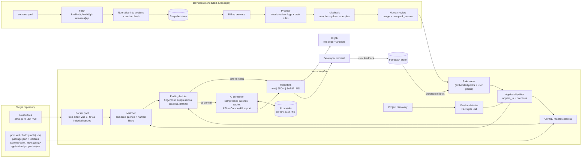

# crev: version-aware code review engine (engineering plan)

> Status: draft v1, 2026-10-09; catalog/grammar/user-rules update 2026-10-10 (Europe/Tallinn). Owner: Elmo.
> Decisions already made:
> * **v1 targets the local CLI and CI only.** PR bots (GitHub/GitLab inline comments) come in a later phase (§14).
> * **The default CI fail threshold is `critical` only.** `crev scan` exits 1 only when at least one gating finding is `critical`. Major, minor and info findings are still reported in text/JSON/SARIF/MD, but they do not fail the build unless `--fail-on` / `.crev.yaml` lowers the threshold.
> * **AI engine = any OpenAI-compatible chat-completions endpoint**, configured with `base_url`, `model` and `api_key_env` (in `.crev.yaml`, or via env `CREV_AI_BASE_URL` / `CREV_AI_MODEL` / `CREV_AI_API_KEY`). When it is not configured, crev **falls back to Cursor-skill mode**: it exports compressed payloads, the `skills/crev-review` skill has the agent in the chat confirm or reject them, and the verdicts come back via `crev ingest` (§8.5).
> * **No AI budget cap.** Cost is controlled by payload compression instead: rule text is deduplicated per batch, context is minimal, identical items are collapsed, findings are batched and verdicts are cached (§8.5).
> * **An undetectable version is assumed to be the latest release** (`unknown_version_policy: assume-latest`). Findings list such dimensions in `assumed_versions` (§5.1).
> * **Report everything.** Rules that mirror ESLint, typescript-eslint or eslint-plugin-vue are not skipped when those linters are configured (§6.6).

Companion artefacts in this directory:

| Path | What |
|---|---|
| `rules/packs/<pack>/<topic>[.gen].yaml` | Catalog: **2613 rules** in 30 packs, one directory per language/framework/file type, one small file per topic (security, taint, migration[-vN], quality, ...); `*.gen.yaml` are generated, the rest hand-edited (layout: `rules/README.md`). Every rule cites an official doc URL and version, plus a verbatim `source.quote` that was found on the page. Counts are in Appendix A. |
| `tools/rulegen/` | Generator for the `*.gen.yaml` topic files (`specs/*.py`, routed by `layout.py`). `rulegen.py verify` re-fetches every cited URL and checks the quote; `sources.py` regenerates `sources.yaml` and the citation index in `sources.md`. |
| `cmd/crev`, `internal/{config,ai,report}` | The working CLI: `scan` (text/json/sarif/md, exit codes), `ai export/run/status`, `ingest`, `versions`, `rules list/show/validate`. |
| `.crev/rules/*.yaml` (user repo) | User rules layered over the catalog by id (add / patch / replace / disable), validated with `crev rules validate` (§6.7, `rules/README.md`). |
| `skills/crev-review/SKILL.md` | Cursor skill for the no-API fallback: run crev, confirm/reject the exported payloads, and write the verdicts back with `crev ingest`. |
| `schemas/rule-pack.schema.json` | JSON Schema for the rule packs. All packs validate against it. |
| `schemas/custom-rules.schema.json` | Schema for user rule files in `.crev/rules/` (complete rules, patches, `override: replace`, `disabled: true`). |
| `schemas/finding.schema.json` | Finding schema (native JSON, maps 1:1 to SARIF 2.1.0) |
| `schemas/ai-handoff.schema.json` | AI handoff v2: compressed batch (rules deduplicated by id, minimal items) and verdict/response contract |
| `sources.md` / `sources.yaml` | Official doc seed list for the update pipeline (613 URLs, including every rule citation; all HTTP 200 on 2026-10-09) |
| `tools/rulecheck` (+ `internal/rulecheck`) | Working Go validator (the same checks back `crev rules validate`). It compiles every tree-sitter query against the real grammar and runs golden checks (the bad example must match, the good example must not). |
| `tools/sexp` | Prints the tree-sitter tree of a file, for rule authors |
| `internal/config/template.crev.yaml` (`crev init`) | Shipped default config template (`fail_on: critical`, `unknown_version_policy: assume-latest`, `ai.mode: auto` with API → Cursor-skill fallback, no budget) |
| `.crev.yaml` (repo root) | Repo-local config for scanning crev itself: ignores `rules/packs/**`, `tools/rulegen/specs/**` (deliberate bad examples), vendored grammar C sources, testdata; `ai.mode: off`. Self-scan gates 0. |
| `internal/grammars` | Grammar registry (18 grammars, §3.1): java, javascript, typescript, tsx, go, python, php, kotlin, groovy, json, yaml, xml, hcl, html via official/maintained Go bindings; **vendored** vue, dockerfile, proto, graphql |

`go run ./tools/rulecheck rules/packs/*/*.yaml` → `total=2613 failures=0`. JavaScript rules are also checked under the TypeScript grammar and `jsx` rules under TSX. All packs validate against `schemas/rule-pack.schema.json`, and `tools/rulegen/rulegen.py verify` passes with 0 problems for every generated pack (the 127 base rules were verified by hand earlier). `go test ./...` is green.

---

## 0. TL;DR

* **What it is:** a Go CLI (`crev`) that does the following:
  1. Finds the project units in a repo and works out their **version facts**: Java release, Spring Boot/Framework/Security, Vue, Nuxt, TypeScript, tsconfig options, ECMAScript level.
  2. Loads **rules stored as data** (YAML). Each rule carries tree-sitter queries, a version range, a severity, a detection mode and a doc citation.
  3. Parses Java/JS/TS/TSX/Vue with **tree-sitter**. Vue `<script>` blocks are parsed in place using *included ranges*.
  4. Emits **findings** as text, JSON or SARIF.
  5. Sends `ai-confirm` findings to a pluggable AI provider, with the code context, rule text, citation and a precise yes/no question.
* **Parser bindings:** use the **official `github.com/tree-sitter/go-tree-sitter`**, pinned to a master pseudo-version. Vendor the Vue grammar. Reasons in §3.
* **Updatability:** a `crev docs` pipeline does the following:
  1. Re-fetches the seed sources and normalises them into sections.
  2. Diffs them against stored snapshots.
  3. Flags rules whose cited section changed.
  4. Drafts *proposed* rules for new deprecations, removals and features.

  Proposals only land after `rulecheck` passes and a human approves the change.

---

## 1. Goals and non-goals

**Goals (v1)**
1. Version-correct findings. Example: no "use records" on Java 11, and no "props destructure loses reactivity" on Vue ≥3.5.
2. Every finding is traceable to an official doc URL and doc version.
3. Deterministic where possible. Where static syntax is not enough (types, intent), use AI confirmation with a bounded, cached and auditable payload.
4. Rules are data, versioned and testable. Adding a rule needs no Go code unless it needs a new named filter.
5. CI-friendly: SARIF and JSON output, stable fingerprints, a baseline, diff-only mode and well-defined exit codes.

**Non-goals (v1)**
* PR/MR bots and inline review comments (Phase 5).
* Full type resolution. We do not embed javac or tsc. TypeScript 7.0 has no programmatic API yet, so a type-aware TS integration waits for 7.1+ (see risks).
* Autofix and code rewriting. We output `fix` text only. OpenRewrite or codemod integration is an open question.
* Replacing ESLint, eslint-plugin-vue, typescript-eslint or Error Prone. We cross-reference them (§6.6).

---

## 2. Architecture

### 2.1 Components

| # | Component | Responsibility |
|---|---|---|
| 1 | **Project discovery** | Walk the repo; find *project units* (dirs with `pom.xml`, `build.gradle(.kts)`, `package.json`, `nuxt.config.*`, `tsconfig*.json`); respect `.gitignore`, `.crevignore` and workspaces. |
| 2 | **Version detector** | Produce a `Facts` map per unit, e.g. `java=21`, `spring-boot=3.3.4`, `vue=3.4.21`, `tsconfig.strict=true`. Each fact records its provenance (§5). |
| 3 | **Rule loader/index** | Load the embedded packs plus user packs, validate them against the schema, apply `.crev.yaml` enable/disable/severity settings, and index rules by `(grammar, target)`. |
| 4 | **Applicability filter** | For each unit, keep the rules whose `applies_to` ranges hold for the facts, then apply `overrides` (severity/message by version). |
| 5 | **Parser pool** | One tree-sitter parser per worker goroutine per grammar. A Vue SFC is split into blocks using included ranges (§4). |
| 6 | **Matcher** | Per grammar, compile the queries once and share them read-only. Run them over each tree, apply named Go filters, and emit raw matches. |
| 7 | **Config/manifest checkers** | Run the `engine: config` checks (properties/yml/json keys) and `engine: manifest` checks (dependencies, paths, Java release). |
| 8 | **Finding builder** | Location, snippet, enclosing symbol, fingerprint, suppressions (`crev-ignore`), baseline and diff filtering. |
| 9 | **AI confirmer** | For `ai-confirm` findings: build the handoff (§8), deduplicate and cache, call the OpenAI-compatible provider in parallel (no budget cap; payloads are compressed), or export to the Cursor skill when no provider is configured, merge the verdicts, and record audit data. |
| 10 | **Reporters** | text, JSON (`finding.schema.json`), SARIF 2.1.0, and a Markdown summary for CI logs and job summaries. |
| 11 | **Docs pipeline** (`crev docs`) | fetch → normalise → snapshot → diff → propose; produces review reports and draft rule YAML (§7). |
| 12 | **Feedback store** | TP/FP verdicts from humans and the AI, giving per-rule precision metrics and auto-demotion (§8.6). |

### 2.2 Data flow



### 2.2a File selection and default exclusions (implemented: `internal/engine/exclude.go`)

The walker decides which files get rule review. Each layer below is on by default and can be switched off.

| Layer | What it skips | Opt-out |
|---|---|---|
| Default dirs | `node_modules`, `vendor`, `bower_components`, `__pycache__`, `.nuxt`, `.next`, `.output`, `.svelte-kit`, `.angular`, `.astro`, `.vercel`, `.turbo`, `.cache`, `.parcel-cache`, `.vite`, `dist`, `build`, `out`, `target`, `.gradle`, `coverage`, `.nyc_output`, `.venv`/`venv`, `.tox`, `.mypy_cache`, `.pytest_cache`, `.ruff_cache`, `.terraform`, `.terragrunt-cache`, `__generated__`, IDE dirs. `bin/` and `obj/` are skipped only next to a `.csproj`/`.fsproj`/`.vbproj`/`.sln`, because elsewhere they are often source. | `default_excludes: false` / `--no-default-excludes` |
| Default files | Minified/bundled files (`*.min.js`, `*.min.css`, `*.bundle.js`, `*.chunk.js`), `*.map`, generated protobuf/gRPC code (`*.pb.go`, `*_grpc.pb.go`, `*_pb2.py`, `*_pb2_grpc.py`, `*_pb.js`, `*.pb.ts`, ...), `*.generated.*`, `*_gen.go`, `zz_generated.*`, `graphql-env.d.ts`. Lockfiles: `package-lock.json`, `npm-shrinkwrap.json`, `yarn.lock`, `pnpm-lock.yaml`, `bun.lock(b)`, `composer.lock`, `go.sum`, `go.work.sum`, `poetry.lock`, `Pipfile.lock`, `uv.lock`, `pdm.lock`, `gradle.lockfile`, `.terraform.lock.hcl`, `Cargo.lock`, `Gemfile.lock`. | same |
| `.gitignore` | Follows git semantics: nested `.gitignore` files scoped to their directory, `!` negations (last match wins, deeper files override), anchored (`/x`, `a/b`) vs. floating patterns, dir-only `x/`, `**`, character classes, escaped `\#`/`\!`, and `.git/info/exclude` as the lowest-precedence source. As in git, a file inside an excluded directory cannot be re-included. | `gitignore: false` / `--no-gitignore` |
| Generated header | Files whose first 2 KiB contain `Code generated ... DO NOT EDIT.` (Go convention, https://go.dev/s/generatedcode), `@generated`, or `<auto-generated`. | `skip_generated: false` / `--include-generated` |
| User globs | `ignore:` in `.crev.yaml` (extra globs). | n/a |

Lockfiles are only excluded from *review*. Version detection (`internal/versions`) still reads them straight from disk: `package-lock.json` lockfileVersion, `pnpm-lock.yaml`, `yarn.lock`, `composer.lock`, `.terraform.lock.hcl`, and so on. Unit markers (manifests, lockfiles) are recorded before the exclusion check, so an excluded lockfile still creates and informs its unit.

Tests: `internal/engine/exclude_test.go` covers gitignore semantics, generated headers, an end-to-end scan with each layer, the opt-out of all layers, and lockfile-fed detection.

### 2.3 Scan algorithm (per unit)

```
facts   := versions.Detect(unit)                         // §5
rules   := index.Applicable(facts)                       // range check + overrides
for file in unit.Files (parallel, N workers):
    units := parse.Split(file)                           // Vue → template/script ranges
    for u in units:
        q := matcher.QueryFor(u.Grammar, u.Target)       // one combined query per (grammar,target)
        for m in q.Run(u.Tree):
            r := q.RuleFor(m.PatternIndex)
            if filters.Pass(r, m) and !suppressed(file, r, m):
                emit(Finding{...status: r.mode=="deterministic" ? confirmed : pending_ai})
config/manifest checks → emit
dedupe → baseline/diff filter → AI confirm (pending_ai) → report → exit code
```

All active rules for one `(grammar, target)` are compiled into **one combined query**. Pattern indices map back to rule IDs, and captures are namespaced `@<rule>.<name>` at load time. That gives one tree walk per file instead of one per rule. Text predicates (`#eq?`, `#match?`, `#any-of?`) are evaluated per pattern by go-tree-sitter.

---

## 3. Parser choice: go-tree-sitter bindings

Checked on 2026-10-09 against the repos (and by building them on the box):

| | `github.com/smacker/go-tree-sitter` | `github.com/tree-sitter/go-tree-sitter` (official) |
|---|---|---|
| Maintainer | community (smacker) | tree-sitter org |
| Activity | last commit **2024-08-27** | latest tag **v0.24.0**; master commit 2025-11-12 |
| Grammars | bundled in the module (java, javascript, typescript/tsx, …; **no vue**) | none bundled; import each grammar's own `bindings/go` (java, javascript, typescript+tsx **verified**; vue has no Go binding) |
| Grammar ABI | older runtime | v0.24.0 accepts ABI 13–14; **master accepts ABI 15** |
| Memory model | GC finalizers | explicit `Close()` on Parser/Tree/Query/Cursor (predictable, must not leak) |
| Query predicates | `FilterPredicates` helper | `eq?/not-eq?/any-eq?`, `match?`, `any-of?`, `is?` evaluated in `Matches()` |
| Runtime grammar loading | no | yes (purego `Dlopen` of `.so`/`.dylib`) |

**Recommendation: official bindings.**
* Today's `tree-sitter-grammars/tree-sitter-vue` HEAD (commit `ce8011a`, 2026-01-24) is generated at **ABI 15**. With v0.24.0, `SetLanguage` fails with `Incompatible language version 15. Expected minimum 13, maximum 14`. With master (`v0.24.1-0.20251112183152-c9492002f76e`) it loads and parses fine. This repo's `go.mod` already pins that pseudo-version.
* Fallbacks, in order:
  1. Regenerate the Vue parser with the tree-sitter CLI at ABI 14 and stay on the v0.24.0 tag.
  2. Switch to the next tagged release once one exists.
* The Vue grammar is vendored in `internal/grammars/vue` (MIT licence and commit recorded) behind a 10-line cgo binding.
* **cgo is required.** Release builds need a C toolchain per target: a cross-compile container, or zig as `CC`. Pure-Go/WASM grammar loading is a possible later option; it has not been evaluated.

Grammar pinning: grammars are Go module versions (`tree-sitter-java v0.23.5`, `-javascript v0.25.0`, `-typescript v0.23.2`) plus the vendored Vue commit. A grammar bump is its own PR, which must pass `rulecheck`, because node types are part of the rule contract.

### 3.1 Grammar registry (2026-10-10)

| Grammar id | Files | Binding | Version / commit | Caveats and fallbacks |
|---|---|---|---|---|
| java | `*.java` | official `tree-sitter/tree-sitter-java` | v0.23.5 | |
| javascript / typescript / tsx | `*.js *.mjs *.cjs *.jsx` / `*.ts *.mts *.cts` / `*.tsx` | official | v0.25.0 / v0.23.2 | JSX node types do not exist in the TS grammar: JSX rules use `language: jsx` (javascript + tsx). TS has `public_field_definition` where JS has `field_definition`. |
| vue | `*.vue` | **vendored** `tree-sitter-grammars/tree-sitter-vue` | `ce8011a` (2026-01-24, ABI 15) | no Go binding upstream; script blocks re-parsed with JS/TS (§4) |
| html | `*.html *.htm` | official `tree-sitter/tree-sitter-html` | v0.23.2 | used for Angular external templates; Angular control-flow blocks (`@if/@for/@switch`) and `{{ }}` parse as text, so those rules use regex predicates on text nodes; inline `template:` strings are matched in the TS tree by regex |
| go | `*.go`, `go.mod` facts | official `tree-sitter/tree-sitter-go` | v0.25.0 | `go.mod`/`go.work` are read by version detection, not parsed as Go |
| python | `*.py *.pyi` | official | v0.25.0 | Python 3 grammar (the pack targets Python 3+); Python 2-only syntax yields ERROR nodes and is not targeted |
| php | `*.php *.phtml` | official `tree-sitter-php` (PHP+HTML variant) | v0.25.1 | rules cover PHP 5.4–8.5; HTML outside `<?php ?>` is a text node |
| kotlin | `*.kt *.kts` (`*.gradle.kts` too) | `tree-sitter-grammars/tree-sitter-kotlin` | v1.1.0 | generic calls at top level (`Foo<Bar>(1)`) parse as comparisons; rules match identifiers instead |
| groovy | `*.gradle *.groovy` | `amaanq/tree-sitter-groovy` | v0.1.2 | community grammar; Gradle DSL closures parse as `juxt_function_call`/closures |
| json | `*.json`, JSONC configs | official `tree-sitter-json` | v0.24.8 | JSONC (tsconfig etc.) comments parse as comment nodes; duplicate keys found by structural queries |
| yaml | `*.yaml *.yml` (compose, ytt) | `tree-sitter-grammars/tree-sitter-yaml` | v0.7.2 | ytt annotations (`#@`) are comments: ytt rules match comment text; Starlark in `*.star` has no grammar (regex on text) |
| xml | `pom.xml`, `*.xml` | `tree-sitter-grammars/tree-sitter-xml` | v0.7.0 | |
| hcl | `*.tf *.tfvars *.hcl` | `tree-sitter-grammars/tree-sitter-hcl` | v1.2.0 | Terraform semantics (provider schemas) are not resolved; provider-version rules rely on `required_providers` facts |
| dockerfile | `Dockerfile*`, `*.dockerfile`, `Containerfile*` | **vendored** `camdencheek/tree-sitter-dockerfile` | `971acdd` (2025-01-12) | latest tag has no Go binding; heredocs supported; an `ARG X=` with empty default produces an ERROR node (the rule for it matches file text) |
| proto | `*.proto` | **vendored** `coder3101/tree-sitter-proto` | `d7d1542` (2026-10-07) | upstream go.mod needs Go 1.26, so the C sources are vendored; proto2/proto3/editions (`edition = "2023"/"2024"`) all parse |
| graphql | `*.graphql *.gql` | **vendored** `bkegley/tree-sitter-graphql` | `5e66e96` (2021, ABI 13) | unmaintained but complete for SDL + executable documents; GraphQL embedded in JS/TS template literals (gql``) is not parsed, only `.graphql/.gql` files are reviewed |

No grammar (fallbacks): Starlark (ytt `*.star`, regex on text), `.properties`/`application.yml` Spring config (dedicated config engine), `gradle.properties` / `libs.versions.toml` (version detection only).

---

## 4. Vue SFC handling

1. Parse the whole `.vue` file with the **vue grammar**. Top-level nodes are `template_element`, `script_element` and `style_element`, each with a `start_tag` and `raw_text`.
2. For each `script_element`, read the attributes: `lang` (`ts`, `tsx`, `js`, `jsx`; the default is js) and `setup`. Re-parse **the same byte buffer** with the TS/TSX/JS parser restricted to the `raw_text` byte range via `Parser.SetIncludedRanges`. Because of that, all positions are already in `.vue` file coordinates and no offset remapping is needed. This is tree-sitter's standard multi-language technique.
3. Rules declare a `detection.target`:
   * `template` → query the vue tree. Directive names, modifiers, attribute values, interpolations and tags are available. Examples: `VUE-MIG-NATIVE-001`, `VUE-QUAL-VFOR-KEY-001`.
   * `script` → query the TS/JS tree of the script block(s). The same rule can also run on plain `.ts`/`.js` files via `files:` globs. Example: `VUE-MIG-GLOBAL-API-001` on `main.js`.
   * `style` → reserved (scoped/module checks use the template tree's `style_element`).
4. **Template expressions** (`{{ }}`, `:prop="expr"`, `@evt="handler"`) are JavaScript. Phase 4 parses them with the JS grammar via included ranges, with special cases: `v-for="x in xs"`, `v-slot` destructuring, and Vue 2 filters (`a | f`), which are not valid JS.
5. File-level facts for Vue: `vue.api_style ∈ {options, composition, script-setup}` (derived from `export default {}`, `setup()`, or `<script setup>`), so rules can target, for example, Options-API-only migrations.
6. Shorthand nuance found while authoring: in the vue grammar, `:key` / `@click` appear as `directive_attribute` → `directive_value` (the shorthand token is anonymous). `v-for` / `v-if` appear as `directive_name`. Modifiers are `directive_modifiers/directive_modifier`. The rules account for this, and `tools/sexp vue file.vue x` prints the outline.

---

## 5. Version detection

### 5.1 Facts model

```go
type Fact struct {
    Key        string   // "java", "spring-boot", "vue", "tsconfig.target", "dependency:org.springframework.boot:spring-boot-starter-undertow"
    Value      string   // normalised: "21", "3.3.4", "es2022", "true"
    Confidence string   // exact | range-min | inferred | default
    Provenance []string // "pom.xml:42 <java.version>", "pnpm-lock.yaml: vue@3.4.21"
}
```

Ranges in `applies_to` use comparator sets (`">=3.0 <3.5"`, `">=21"`, `"<17 || >=25"`). Java versions are plain feature numbers; everything else is semver. A rule applies only if **every** key holds. When a dimension is clearly present but its version cannot be detected (for example `*.vue` files without a `package.json` version, Spring imports without a resolvable Boot version, or Java sources without a release setting), **crev assumes the latest known release** from `rules/data/latest-versions.yaml` (JDK 27, Boot 4.1.1, Framework 7.0.9, Security 7.0, Vue 3.5.43, Nuxt 4.6.0, TS 7.0.2, ES2026). The fact is marked `assumed: true` with that provenance, `crev versions` shows it as "(assumed latest)", and each affected finding lists it in `assumed_versions`. This is `unknown_version_policy: assume-latest` (decided 2026-10-09, the default). The only alternative is `skip`, which leaves the dimension absent so version-gated rules do not run. The old `warn` value is rejected with an explanatory error. A dimension that is absent altogether (for example no Vue at all) still means its rules do not apply.

### 5.2 Sources by ecosystem (precedence top → bottom)

| Fact | Sources |
|---|---|
| `java` | Maven: `maven.compiler.release` → `<release>` in maven-compiler-plugin → `maven.compiler.source/target` → `<java.version>` (Spring Boot parent convention), with property interpolation through the in-repo parent chain. Gradle: `java { toolchain { languageVersion = JavaLanguageVersion.of(N) } }` → `sourceCompatibility`/`targetCompatibility` → `options.release`; Groovy and Kotlin DSL, parsed heuristically. Hints only: `.java-version`, `.sdkmanrc`, `.tool-versions`, `Dockerfile` base image. Optional `--resolve` runs `mvn help:effective-pom` / `gradle properties`. |
| `spring-boot` | `spring-boot-starter-parent` version; imported `spring-boot-dependencies` BOM; Gradle plugin `org.springframework.boot` version; `gradle/libs.versions.toml`. |
| `spring-framework`, `spring-security` | Explicit pins; otherwise derived from Boot via a generated **BOM table** (data file built from Spring Boot release BOMs by the docs pipeline). |
| `vue`, `nuxt`, `typescript`, any npm dep | Lockfile resolved version (package-lock v2/v3 `packages`, yarn v1 and Berry, `pnpm-lock.yaml`, `bun.lock`) → else the `package.json` range minimum (`Confidence=range-min`). Handles npm aliases such as `"typescript": "npm:@typescript/typescript6@^6.0.2"` and `@typescript/native` (the TS 7 side-by-side setup from the TS 7.0 announcement). Workspace-aware (nearest package.json wins). |
| Vue migration build | `@vue/compat` present → `vue.compat=true`. Both Vue 2 deprecations and Vue 3 removals fire, as migration findings. |
| Nuxt flavour | `nuxt` / `@nuxt/bridge`; `nuxt.config` `future.compatibilityVersion` (4 on Nuxt 3.x, 5 on Nuxt ≥4.2 per the upgrade guide) sets `nuxt.compat`, which rules can opt into. Nuxt implies the Vue major. |
| `tsconfig.*` | `tsconfig*.json` (JSONC) with the full `extends` chain, including packages in `node_modules` (`@vue/tsconfig`, `@tsconfig/*`) and arrays of extends. Every resolved `compilerOptions.X` becomes a fact. |
| `go`, `go.toolchain` | `go.mod` `go` and `toolchain` directives (`go.work` for workspaces). |
| `python` | `pyproject.toml` `requires-python` → `[tool.poetry.dependencies] python` → `.python-version` → `runtime.txt` → `setup.cfg python_requires` → `Pipfile`. |
| `php`, `composer`, `laravel`, `symfony` | `composer.json` `config.platform.php` → `require.php`; framework packages from `require`; `composer.lock` `plugin-api-version` for the Composer version. |
| `gradle`, `kotlin` | `gradle/wrapper/gradle-wrapper.properties` distributionUrl; Kotlin Gradle plugin version (`plugins { kotlin("jvm") version … }`, `kotlin_version`, `libs.versions.toml`). |
| `maven` | `.mvn/wrapper/maven-wrapper.properties`; `pom.xml` `modelVersion 4.1.0` ⇒ Maven 4. |
| `terraform`, `tf-provider.<name>` | `terraform { required_version }`, `required_providers` constraints, `.terraform.lock.hcl` resolved versions, `.terraform-version`. |
| `dockerfile` | `# syntax=docker/dockerfile:1.x` parser directive (else assumed latest frontend). Compose files are versionless (Compose Specification). |
| `angular`, `react`, `nuxt-ui`, `payload`, `vueuse`, `graphql` | npm lockfile/`package.json` like other npm deps (`@angular/core`, `react`, `@nuxt/ui`/`@nuxt/ui-pro`, `payload`, `@vueuse/core`, `graphql`). |
| `ytt` | Presence from `#@` annotations / `_ytt_lib` / `*.star`; minimum from `version.require_at_least("x.y.z")`. |
| `protobuf` syntax | Per file: `syntax = "proto2"/"proto3"` or `edition = "…"`, matched by rule file filters (not a unit fact). |
| `ecmascript` | Lowest of: `tsconfig.target` (`ESNext` → latest known edition); ESLint `ecmaVersion`; `browserslist` → ES edition via a data table; `engines.node` → ES edition via a data table. The tables live under `rules/data/` and are maintained by the docs pipeline. Mark these as `inferred`. |

`crev versions [path]` prints the facts with provenance. It is the first thing to check when a finding looks wrong. Overrides: `crev scan --fact java=21` or `.crev.yaml: facts:`.

### 5.3 Examples of version-gated behaviour already in the catalog

* `JAVA-QUAL-VT-002` (synchronized pinning) applies only to `java: ">=21 <24"`, because JEP 491 fixed pinning in 24.
* `SB-MIG-MOCK-001` is `minor` on Boot ≥3.4 (deprecated) and an override makes it `critical` on ≥4.0 (removed).
* `VUE-QUAL-PROPS-DESTRUCT-001` applies on `vue: ">=3.0 <3.5"` only, because 3.5 stabilised Reactive Props Destructure.
* `TS-MIG-CFG-TARGET-ES5-001` is `major` on TS 6.x and `critical` on ≥7.0.
* `SB-QUAL-VT-001` uses two dimensions: `spring-boot >=3.2` **and** `java >=21`.
* `TS-MIG-VUE-TS7-001` is cross-ecosystem: `typescript >=7.0` plus `vue` present → vue-tsc needs TS 6.

---

## 6. Rule DSL and schema

Formal schema: `schemas/rule-pack.schema.json`. A pack is `{pack, pack_version (CalVer), rules[]}`.

### 6.1 Rule fields

| Field | Notes |
|---|---|
| `id` | `PACK-TOPIC-NNN`, stable forever. Renames go through `status: deprecated` plus `replaced_by`. |
| `title`, `message`, `rationale?`, `fix?` | Message text should paraphrase the doc and quote it only briefly (licensing, §15). |
| `language` | Grammar family: `java`, `javascript`, `typescript`, `tsx`, `vue`; or the non-code kinds `properties`, `tsconfig`, `manifest`. |
| `framework?` | e.g. `nuxt`, for grouping and reports. |
| `kind` | `best-practice`, `anti-pattern`, `deprecation`, `removal`, `migration`, `security`, `modernization` |
| `category` | Free-form (`concurrency`, `reactivity`, `ssr`, …) |
| `severity` | `info`, `minor`, `major`, `critical` (SARIF mapping §9) |
| `applies_to` | Map of fact → range (all must hold) |
| `overrides[]` | `{when: {fact: range}, severity?, message?}`; the first match wins |
| `detection.mode` | `deterministic` or `ai-confirm` |
| `detection.engine` | `tree-sitter`, `config` or `manifest` |
| `detection.target` | Vue only: `template` or `script` |
| `detection.grammar?` | Override the grammar |
| `detection.files?` | Globs (e.g. `nuxt.config.ts`, `composables/**`) |
| `detection.query` | tree-sitter query; **must** capture `@match`, which is the reported node |
| `detection.filters[]` | Named Go post-filters for things queries cannot express (§6.3) |
| `detection.config` / `manifest` | Declarative key/dependency checks |
| `ai_question` | Required for `ai-confirm`. A single closed question the agent must answer. |
| `source` | `{url, doc, doc_version, retrieved, quote?, anchor_text?, content_hash?}`. `quote` is a short verbatim phrase from the page (checked by `rulegen.py verify`, sent to the AI as evidence). `anchor_text` and `content_hash` are filled by the docs pipeline. |
| `examples.bad` / `examples.good` | Executable golden tests (validated by `rulecheck`) |
| `status`, `rule_version`, `tags`, `xref?` | `xref` links equivalent lint rules, e.g. `eslint:no-var`, `vue:no-deprecated-filter`, `ts-eslint:no-explicit-any` |

### 6.2 Example (from `rules/packs/java/quality.yaml`)

```yaml
- id: JAVA-QUAL-VT-001
  title: Never pool virtual threads
  language: java
  kind: anti-pattern
  category: concurrency
  severity: major
  applies_to: { java: ">=21" }
  detection:
    mode: deterministic
    engine: tree-sitter
    query: |
      (method_invocation
        object: (identifier) @o (#eq? @o "Executors")
        name: (identifier) @n (#any-of? @n "newFixedThreadPool" "newCachedThreadPool" "newScheduledThreadPool" "newWorkStealingPool")
        arguments: (argument_list
          (method_invocation
            object: (method_invocation name: (identifier) @ov (#eq? @ov "ofVirtual"))
            name: (identifier) @f (#eq? @f "factory")))) @match
  message: A thread pool is backed by a virtual-thread factory. Virtual threads are cheap ...
  source: { url: "https://docs.oracle.com/en/java/javase/21/core/virtual-threads.html",
            doc: "Virtual Threads (Adoption Guide: 'Never Pool Virtual Threads')",
            doc_version: "Java SE 21", retrieved: "2026-10-09" }
  examples:
    bad:  "class A { void f() { var ex = Executors.newFixedThreadPool(10, Thread.ofVirtual().factory()); } }"
    good: "class A { void f() { try (var ex = Executors.newVirtualThreadPerTaskExecutor()) { ex.submit(() -> 1); } } }"
```

### 6.3 Named filters (Go registry)

Queries cannot express "absence" or file-level conditions. Filters are small, tested Go functions referenced by name:

| Filter | Meaning |
|---|---|
| `vue.start_tag_lacks_attr:<name>` | The start tag has no `name`, `:name` or `v-bind:name` (used for `v-for` without key, and `<style>` without scoped/module) |
| `file.lacks_text:<s>` | Cheap file-level guard (e.g. no `emits` anywhere) |
| `node.lacks_ancestor:<type>` | The match is not inside a node of the given type |
| Planned | `java.class_has_annotation`, `java.same_class_calls:<capture>` (for `SB-QUAL-TX-001` self-invocation → deterministic), `js.in_setup_scope`, `ts.import_from:<module>` (only flag `ref()` imported from `vue`) |

### 6.4 Query authoring conventions (learned while building the catalog)

* **Predicates must sit inside the pattern's parentheses.** `(comment) @m (#match? @m "x")` at top level silently matched everything. The right form is `((comment) @m (#match? @m "x"))`. `rulecheck` caught it because the good example matched.
* Field order and sibling order matter. Java `modifiers` lists annotations before keywords, so use `#match?` on the `@mods` capture text rather than ordered anonymous tokens (see `SB-QUAL-TX-002`).
* Use alternations `[ … ]` for "either order" (`VUE-QUAL-VIF-VFOR-001`).
* JS rules must also work on the TypeScript grammar (it is a superset with the same node names). `rulecheck` enforces this.
* Prefer `@match` on the smallest meaningful node, so SARIF regions are tight.

### 6.5 Rule lifecycle and versioning

* `status: proposed` (from the docs pipeline) → `active` (after review) → `deprecated` (kept for one pack release so baselines don't churn).
* `rule_version` is bumped on any semantic change (query, applies_to, severity). Fingerprints include `rule_id` but **not** `rule_version`, so baselines survive message tweaks.
* `pack_version` uses CalVer (`2026.10.0`). The binary embeds a pack set; `crev rules update` can pull a newer signed bundle (open question: distribution channel).

### 6.6 Relationship to existing linters

Many JS/Vue/TS rules mirror ESLint, eslint-plugin-vue or typescript-eslint rules, whose docs are cited as cross-references. Value-add: version gating across ecosystems, one report, and AI confirmation. **Decision (2026-10-09): report everything.** crev does not skip a rule because ESLint, typescript-eslint or eslint-plugin-vue already enforce its `xref`, so the `--skip-xref-enabled` idea is dropped. Teams that want less overlap can disable individual rules in `.crev.yaml` (`rules: { JS-NO-VAR: { enabled: false } }`). The generated mirrors carry a `src:<plugin>/<rule>` tag, so overlap stays visible in SARIF tags.

### 6.6a Respecting project tool configuration (implemented: `internal/projcfg`, 2026-10-10)
"Report everything" still holds: a linter being installed, or a rule not being enabled in it, never hides a crev finding. Only **explicit user configuration** suppresses: a rule switched off in a config file, or an inline disable comment. Suppressed findings get `status: suppressed` and `suppressed_by {kind: config|inline|crev-ignore, tool, id, source}`. They stay in JSON, appear in SARIF as `suppressions` (`external` for config, `inSource` for comments, with a justification), never gate, and become `suppressed` in the branch ledger. Text and Markdown output hide them behind a one-line count; `--show-suppressed` lists them. `respect_project_config: true` is the default; `false` or `--no-project-config` ignores config files and linter comments, while `crev-ignore` still applies.
* **Equivalents.** Rule `xref` entries may be URLs, related crev rule ids, or `tool:id` linter equivalents. The shipped mapping `rules/data/xref.yaml` is generated by `tools/rulegen/xref.py` from the rules' doc URLs: eslint, typescript-eslint, eslint-plugin-vue, @graphql-eslint, react-hooks, ruff (with the upstream flake8/pylint/bandit code, via `ruff rule --all`), go vet analyzers, tflint and Docker build checks. A reviewed manual table adds hadolint, buf, yamllint, gosec/staticcheck/revive, Error Prone/SpotBugs/PMD/Checkstyle, detekt, Psalm/PHPCS, typescript-eslint/tsconfig, bandit, checkov and editorconfig. Current coverage: **487 rules, 553 links**. stylelint and Prettier have no crev counterparts (n/a).
* **Config discovery** (any directory; a config applies to its subtree; per-file globs and overrides are honoured):
  * ESLint flat `eslint.config.{js,mjs,cjs,ts,mts,cts}`: static tree-sitter read of every `{files, ignores, rules}` object; later objects win.
  * Legacy `.eslintrc{,.json,.yaml,.yml,.js,.cjs}` and `package.json#eslintConfig`, including `overrides[].files/excludedFiles`.
  * `tsconfig*.json` / `jsconfig.json`, following relative `extends` chains. Relaxed options (`allow*`/`skip*`/`suppress*` = true, other flags = false) count as off.
  * `.golangci.{yml,yaml,toml,json}` v1 and v2: `linters.disable`, govet `disable`/`disable-all`+`enable`, staticcheck `checks: ["-SA1019","-ST*"]`, gosec `excludes`, revive `disabled`, path-only `exclude-rules`/`exclusions.rules`, `exclusions.paths`. Also `staticcheck.conf` and `revive.toml`.
  * `detekt.yml` (`active: false` per rule or rule set, `excludes`, options as params) and `.editorconfig` (section globs; `max_line_length`, `trim_trailing_whitespace`, `insert_final_newline`, `end_of_line`, `ktlint_<set>_<rule> = disabled`).
  * Checkstyle `checkstyle.xml` (`severity=ignore`, properties as params) and suppressions XML.
  * PMD ruleset `<exclude>`, SpotBugs exclude filters (Bug + Source), Error Prone `-Xep:Name:OFF` in pom.xml/build.gradle(.kts). Configs under `config/`, `etc/`, `.config/` apply to the enclosing module.
  * `phpstan.neon(.dist)` `ignoreErrors` identifiers with path(s); `psalm.xml` issueHandlers `suppress` (also per directory/file); `phpcs.xml` `<exclude>`, `<severity>0`, `<exclude-pattern>`.
  * `pyproject.toml`: ruff `ignore`/`extend-ignore`/`per-file-ignores` (code prefixes honoured), `line-length`; pylint messages control; mypy `disable_error_code`; bandit `skips`; flake8 via pyproject plugins. Also `ruff.toml`/`.ruff.toml`, and `setup.cfg`/`tox.ini`/`.flake8`/`.pylintrc`/`mypy.ini`/`.bandit`. A small TOML subset reader keeps this dependency-free.
  * `.hadolint.yaml` `ignored`, `.tflint.hcl` `enabled = false`, `.yamllint` (`disable`, options, per-rule and global `ignore`), `buf.yaml` (`except`, `ignore`, `ignore_only`), `.checkov.yaml` `skip-check`.
* **Inline comments**:
  * ESLint: `eslint-disable-next-line|-line|disable…enable [rules]`.
  * Go: `//nolint[:linters]` (same line, or the whole following declaration), `//lint:ignore|file-ignore`, `#nosec [G…]`.
  * Python: `# noqa[: codes]`, `# ruff|flake8: noqa` (file-wide), `# pylint: disable=` (line or rest of block), `# type: ignore[code]`, `# nosec [B…]`.
  * JVM: `@SuppressWarnings`, `@Suppress` and `@SuppressFBWarnings` over the annotated declaration (`all`, `PMD[.Rule]`, `checkstyle:x`, `detekt:X`, `ktlint:…`, Error Prone/SpotBugs names, `crev:RULE`).
  * PHP: `phpcs:ignore|disable…enable|ignoreFile`, `@phpstan-ignore[-next-line|-line] [ids]`, `@psalm-suppress` (next declaration).
  * Infrastructure and schema files: `# hadolint ignore=` (next instruction, including continuation lines) and `# hadolint global ignore=`; Dockerfile `# check=skip=…|all`; `# tflint-ignore:` (next line or block); `#checkov:skip=` (enclosing block); `# yamllint disable-line|disable…enable|disable-file`; `// buf:lint:ignore`.
  * crev-native: `crev-ignore[-next-line|-file] RULE-ID[,…]|all`.
* **Rule params.** A rule may declare `params: {name: {default, from: ["tool:id.option", …]}}` and reference `${name}` in filters, title and message. The engine substitutes the project's configured value per file. `YAML-QUAL-LINE-LENGTH` follows yamllint `line-length.max` or `.editorconfig max_line_length`, and the parsed options of ESLint `max-len`, ruff/flake8/pylint line length, detekt and Checkstyle are available for further rules. rulecheck validates params and xref shapes; examples run with the defaults.
* Tests: `internal/projcfg/projcfg_test.go` (60 config decisions across all formats, 45 inline cases, the ConfigOff behaviour, TOML) and `internal/engine/projcfg_test.go` (end-to-end suppression with source attribution, config off, the yamllint max param).

### 6.6b Simplification layer (Ponytail) and the repo index (implemented: `internal/index`, 2026-10-10)

Guidance: the Ponytail ladder (YAGNI -> already exists -> stdlib -> native platform -> installed dependency -> one line -> minimum code; no extra abstraction or middle man; deletion beats addition; deliberate shortcuts carry a `ponytail:` note with a *ceiling* and an *upgrade path*; one shared fix beats N call-site patches; non-trivial logic gets a runnable check). It is "not lazy about" security, correctness, data integrity and concurrency, and those concerns are routed to the bug/security rules.

- **Repo index** (`internal/index`). One tree-sitter pass over every indexed file (Go, Python, JS/TS/TSX, Java, Kotlin, PHP). It collects symbols with kind, exported flag, params, statement count, cyclomatic-ish complexity, an alpha-renamed body hash (parameters and locals renamed; callees and fields kept) and a pass-through delegate target. It also collects call sites with their enclosing function and imports, resolved to repo files (JS/TS relative paths plus `@/`/`~/`/`src/`; Python relative/absolute), `ImportedBy`, identifier references (templates/JSON/YAML/HTML/Vue included as text), test-file identifiers, `ponytail:` comments, nested collection loops that compare an outer and an inner element, and package-level locks. Manifest dependencies come from the version units. The index is built only when an `engine: index` rule is active, and always over the full tree; scopes only restrict reporting. Stats are `index_*`. `crev index [--json|--symbol N|--file P]` exposes it.
- **Engine `index`** with `detection.check`: `unused-export`*, `unused-flag`, `unused-file`*, `middle-man`, `nested-loop-no-ponytail`, `ponytail-incomplete`, `global-lock-no-ponytail`, `duplicate-helper` (ai-confirm), `helper-replacement` (ai-confirm; config `names`/`name_re`/`api`/`uses`/`requires_loop`/`max_lines`/`dependency`; `requires_dependency` gates installed-dependency replacements), `call-site-patches`* (ai-confirm), and `test-missing`* (category `test`). Checks marked * report only in diff scans (new code); `unused-export` also takes `full_scan: true`. Each hit carries `evidence` (index facts). The evidence is shown in the report and sent to the AI step (handoff `items[].evidence`, part of the cache key; prompt 2026-10-10.1).
- **Advisory cap**: categories `simplification` and `test` are capped at `minor` (even through `.crev.yaml` severity overrides) and `report.Gating` never fails CI on them. rulecheck rejects catalog rules above minor in these categories.
- **Routing**: index checks skip test files and security/correctness-sensitive names (auth, crypt, token, lock, retry, migrate, ...). A simplification finding that overlaps a security/correctness/concurrency/resource-leak/error-handling/... finding is dropped (stat `simplification_rerouted`), so the bug/security finding is the one reported.
- **Files** `rules/packs/{go,python,javascript,java,kotlin,php}/simplification.gen.yaml` (tag `simplification`), generated from `tools/rulegen/specs/simplify_*.py` + `_simplify.py`. Every quote is verified by `rulegen.py verify`. JavaScript rules also run on TS/TSX/Vue. Totals: 92 rules = 23 collapsible-loop tree-sitter rules with version ranges (e.g. Go 1.21 `slices.Max`, Go 1.23 `maps.Keys`, ES2019 `Object.fromEntries`, ES2023 `findLast`, Python `Counter`, Java `String.join`, PHP 8.4 `array_any`), 23 helper-replacement rules (stdlib/native/installed dependency such as lodash), and 46 repo-index rules.
- **Index examples** in rulecheck: `examples.bad/good` may hold several files separated by `// file: path` (or `# file:`). `(existing)` marks a file outside the simulated diff; every other file counts as new and fully changed.
- Known limits: references are name-based, not type-resolved, so a same-named symbol elsewhere hides an unused export (this is conservative). Vue SFC scripts are indexed as text references only. Go import paths are not resolved to directories (Go uses package-level refs).

### 6.7 User rules: `.crev/rules/` (implemented 2026-10-10)

Rules are data, and users own data too. Every `*.yaml|*.yml` under `.crev/rules/` (or the paths in
`.crev.yaml custom_rules:`) is layered over the embedded catalog **by id** (`internal/rules/custom.go`):

* new id → **add** (complete rule, same schema; pack name from the file, default `custom`);
* built-in id with some fields → **patch** (deep merge: maps merge, scalars and lists replace), e.g. change `severity`, narrow `detection.files`, adjust `applies_to`, add `filters`, rewrite `message`;
* `override: replace` → **replace** the built-in entirely;
* `disabled: true` → **disable**.

Files apply in lexical order (later wins). Unknown fields, unknown ids for disable/replace and duplicate ids per file are errors, so typos never silently do nothing. The effective rule records `origin: custom` and the built-in file it changed; `crev rules list --origin custom` and `crev rules show ID` expose that.
`crev rules validate [paths] [--strict] [--skip-examples] [--json]` runs the catalog checks (`internal/rulecheck`, shared with `tools/rulecheck`): required fields/enums, version-range syntax, top-level predicates, query compiled against the real grammar(s), and golden examples executed through the engine. A missing citation is a warning for user rules (`--strict` makes it fail). Schema: `schemas/custom-rules.schema.json`. Docs: `rules/README.md`. `.crev/` is excluded from scans. `rules_dir`/`--rules-dir` still *replaces* the catalog (catalog development only).
The compiled-query cache is keyed by rule id **and** query text, so an override never reuses a stale built-in query.

---

## 7. Doc ingestion and update pipeline (`crev docs`)

Runs on a schedule (weekly for docs, daily for release feeds) in the **rules repository**, not in user CI.

### 7.0 Implemented now: `tools/ruleupdate` (dev tool, 2026-10-10)

This is the minimal, working subset of the pipeline below, run in the rules repo by a maintainer or a scheduled job:

    go run ./tools/ruleupdate [-only SUBSTR] [-cadence weekly] [-limit N] [-offline] [-latest] [-fail-on-review]

- It fetches every `sources.yaml` URL, one request per page; `#fragment` URLs share it. At most `-per-host` (2) requests run per host, `-concurrency` (8) in total, and 429/503 responses are retried with backoff and `Retry-After`. Pages are normalised to text with the same normalisation as `tools/rulegen/fetch.py`.
- Snapshots live in `.ruleupdate/snapshots/<hash>.{txt,json}`, with the previous one kept as `.prev.txt`. Each run diffs against the previous snapshot sentence by sentence. Added sentences that mention deprecation or removal ("deprecated", "will be removed", "no longer supported", "end of life", ...) are listed as **new deprecation lines**.
- **Quote check**: every rule's `source.quote` must still appear on its page. Rules whose quote has disappeared are listed by id under their URL. `-offline` re-checks the quotes against the stored snapshots without network access.
- `-latest` compares `rules/data/latest-versions.yaml` against upstream registries: go.dev/dl JSON, nodejs.org dist index, endoflife.date (python, php, kotlin, gradle, terraform, spring-boot) and npm `latest` dist-tags (vue, nuxt, typescript, react, angular, nuxt-ui, payload, vueuse, graphql, npm, pnpm). Dimensions without a registry are listed for a manual check.
- The output is `.ruleupdate/report.md` (needs-review list) and `report.json`. The tool **never edits rules**. `-fail-on-review` exits 1 when anything needs review, for a scheduled CI job.


1. **Fetch** (`sources.yaml`; strategy per source):
   * `markdown`: raw docs sources, the best for diffing. Vue docs, the Vue migration guide, Nuxt `docs/`, TypeScript-Website release notes, mdn/content, TC39 `finished-proposals.md`.
   * `gh-wiki`: `git clone https://github.com/spring-projects/spring-boot.wiki.git` (migration guides and release notes; raw wiki URLs return 404).
   * `gh-releases`: GitHub Releases API for spring-boot, vuejs/core, nuxt/nuxt and microsoft/TypeScript. This is new-version detection, which triggers fetches of new release-note pages.
   * `jep`: openjdk.org JEP pages; parse the `Status` and `Release` header fields, plus the `projects/jdk/<N>/` feature lists.
   * `html`: the rest (Spring reference, Oracle javadoc and deprecated-list, Oracle release notes). Extract main content, strip navigation, and convert to Markdown.
   * Polite: ETag/If-Modified-Since, rate limits, robots.txt, user agent `crev-docs/<ver>`. Store HTTP status. A 404 creates a "source broken" review item, which is how the 404s listed at the end of sources.md were found.
2. **Normalise into sections.** Split on headings, and give each section a stable key (`url#slug`). Compute `sha256(normalised text)`. Specialised extractors:
   * Oracle `deprecated-list.html` → table rows `{api, since, forRemoval}`
   * JEP → `{number, title, status, release}`
   * TC39 table → `{proposal, edition}`
   * Spring Boot migration guide → `{heading, version}`
   * Vue migration index → list items
   * Nuxt upgrade guide → `{change, impact level}`
   * TS release notes → "Breaking changes" / "Deprecated" subsections
3. **Snapshot store.** Content-addressed blobs and per-run manifests (git-friendly; open question on where they are hosted). Full doc text is stored only if the licence allows it (§15); otherwise only hashes and structural extracts are kept.
4. **Diff.** For each section: added, changed or removed. For each structured extract: new rows. Examples: a new `forRemoval=true` API in JDK N, a new TC39 edition entry, a new Spring Boot `X.Y Migration Guide` page, or a new Nuxt upgrade-guide entry.
5. **Propose.**
   * **Impact on existing rules.** Each rule cites `source.url`, and `anchor_text`/`content_hash` locate its section. A changed or missing section marks the rule `needs-review` in a report.
   * **New-rule drafts.** Templates per extract type:
     * deprecated-list row → Java `deprecation` rule with a `method_invocation`/`object_creation_expression` query skeleton
     * TC39 entry → `modernization` rule gated on `ecmascript >= edition`
     * Boot property rename → `config` rule
   * Optional AI drafting with a strict contract: it may only use the fetched section text, must output schema-valid YAML with `status: proposed`, must cite the exact URL, and must provide bad/good examples.
6. **Validate.** `rulecheck` (schema, query compile, golden examples) plus `rules test` (fixtures). Anything failing is reported, never merged.
7. **Review and release.** The output is a branch or patch plus a Markdown report. A maintainer approves; the merge bumps `pack_version` and generates a changelog. Nothing auto-merges.

Freshness metadata: every rule carries `source.retrieved`. `crev rules list --stale 180d` shows rules whose sources have not been re-verified recently.

---

## 8. AI confirmation design

### 8.1 When the AI is used
* Only for findings from `detection.mode: ai-confirm` rules. There are 131 in the catalog (Appendix A); examples: is this `get()` on an `Optional`, is this `v-html` value user-controlled, is this `@Transactional` method self-invoked.
* Optional later: `--ai-review-deterministic` for spot audits, used to measure FP rates of deterministic rules.
* Modes: `--ai off` (pending findings reported as `pending_ai`, low confidence, never failing CI), `--ai auto` (the default: the cache first, then the OpenAI-compatible API if configured, otherwise a Cursor-skill export), `--ai required` (exit 4 if any finding is still `pending_ai` afterwards).

### 8.2 Handoff payload (v2, implemented: `schemas/ai-handoff.schema.json#/$defs/batch`)

One **batch** is one chat-completions request (API mode) or one line of `.crev/ai-handoff/batches.jsonl` (Cursor-skill mode):

```json
{"schema":"crev.ai-handoff/v2","batch_id":"b5328bbc1c0189de","prompt_version":"2026-10-09.1",
 "rules":{"JAVA-QUAL-OPT-002":{"title":"Prefer Optional.orElseThrow() over get()","msg":"…","question":"Is the receiver of this zero-argument get() a java.util.Optional?",
          "url":"https://docs.oracle.com/en/java/javase/25/docs/api/java.base/java/util/Optional.html","doc_version":"Java SE 25 API","quote":"…"}},
 "facts":{".":{"java":"27 (assumed latest)"}},
 "items":[{"id":"d4d0cf07d749","rule":"JAVA-QUAL-OPT-002","path":"src/main/java/com/acme/OrderService.java","lang":"java","lines":[2,14],
           "code":"7|public String find(Optional<String> o) {\n8|    return o.get();\n…","dups":["9f0e…"]}]}
```

The v1 per-finding design below is kept for reference. v2 replaces it because v1 repeated the rule text, project facts and large contexts for every finding.


```json
{
  "schema_version": "crev.ai-handoff/v1",
  "finding_id": "b1c4…",
  "rule": {
    "id": "SB-QUAL-TX-001",
    "title": "@Transactional self-invocation is not intercepted",
    "message": "In proxy mode only external calls through the proxy are intercepted; …",
    "source_url": "https://docs.spring.io/spring-framework/reference/data-access/transaction/declarative/annotations.html",
    "doc_version": "Spring Framework 7.0 reference",
    "doc_excerpt": "In proxy mode (which is the default), only external method calls coming in through the proxy are intercepted. …",
    "example_bad": "…", "example_good": "…"
  },
  "question": "Is this @Transactional method invoked from another method of the same class (directly or via `this.`)? Provide the call site if so.",
  "code": {
    "path": "src/main/java/com/acme/OrderService.java",
    "language": "java",
    "match": { "start_line": 41, "end_line": 41, "text": "public void save(Order o) {" },
    "context": "38| @Service\n39| public class OrderService {\n40|   @Transactional\n41|   public void save(Order o) { … }\n…\n77|   public void importAll(List<Order> os) { os.forEach(this::save); }\n",
    "related": [ { "path": "…", "reason": "same-class call sites of save", "text": "77| …" } ]
  },
  "project": { "java": "21", "spring-boot": "3.3.4" },
  "response_schema": "#/$defs/response"
}
```

**Context slicing.** The context is the enclosing tree-sitter node: the method, plus the class header with fields and annotations, capped at about 120 lines with line numbers. `related` adds targeted slices: same-class call sites, the declaration of the receiver variable (for `get()`/`stop()` type questions), and imports. Secrets scrubbing runs before sending, using regexes for keys and tokens plus `.crevignore` paths. The excerpt is the cached doc section, trimmed to ≤1,500 characters.

### 8.3 Prompt contract
* The system prompt states that code and comments are **untrusted data** and must never be followed as instructions (prompt injection via comments). The model must answer only the question, using only the provided evidence. No tools or browsing.
* Output: **JSON only**, matching `#/$defs/response`: `{batch_id, results:[{id, verdict: confirmed|rejected|uncertain, confidence: high|medium|low, rationale ≤1200 chars, evidence_lines[], suggested_fix?}]}` (one result per item id). The response is validated. Unknown ids are ignored, an invalid verdict value becomes `uncertain`, and a malformed response is retried; items still missing stay `pending_ai` and are not cached.
* Temperature 0. `prompt_version` is recorded on every finding.

### 8.4 Confidence levels and status
| Origin | status | confidence | CI gating |
|---|---|---|---|
| deterministic match | `confirmed` | `high` | yes |
| ai-confirm, AI not run | `pending_ai` | `low` | no (unless `--strict-pending`) |
| AI `confirmed` | `ai_confirmed` | AI-reported, capped at the rule's `max_confidence` (default `medium` for heuristic rules) | yes, if confidence ≥ `--min-ai-confidence` (default `medium`) |
| AI `uncertain` | `ai_uncertain` | `low` | no; shown as "needs human review" |
| AI `rejected` | `ai_rejected` | n/a | dropped (visible with `--show-rejected`) |

### 8.5 Providers, cost and caching
* Interface: `type Provider interface { Confirm(ctx, []Request) ([]Response, error) }`. Adapters:
  * **`api` (implemented):** `POST {base_url}/chat/completions` on any OpenAI-compatible server (hosted vendors, gateways, vLLM, Ollama and similar). It uses `Authorization: Bearer $<api_key_env>`, `temperature: 0`, and `response_format: {"type":"json_object"}` when `json_mode` is set. Configuration lives in `.crev.yaml` `ai.base_url`, `ai.model` and `ai.api_key_env` (the *name* of an env var; a literal key is never accepted), with optional `ai.headers` whose values may reference `${ENV}`. The env vars `CREV_AI_BASE_URL`, `CREV_AI_MODEL` and `CREV_AI_API_KEY` override the file. `crev ai status` shows how the provider resolved without printing the key.
  * **`cursor-skill` (implemented fallback):** used when `provider: auto` and the API is not fully configured, or forced with `provider: cursor-skill`. `crev scan` (or `crev ai export`) writes `.crev/ai-handoff/batches.jsonl`, with the instructions embedded. The agent following `skills/crev-review/SKILL.md` answers each item and writes `responses.jsonl`. `crev ingest [-root P] responses.jsonl` then applies the verdicts to `.crev/report.json`, fans them out to `dups`, writes the cache, re-renders the report and exits with the gate result. Ingest accepts a `{"results":[…]}` object, an array, or JSONL of verdicts. The same flow covers air-gapped and human-in-the-loop review.
  * `exec` (later): pipe batches through a local agent CLI.
* Cache key: `sha256(rule_id, rule_version, prompt_version, normalised context, model)`, stored in `.crev/cache/ai` (and restorable as a CI cache). Re-runs on unchanged code cost nothing.
* **No budget cap (decided 2026-10-09).** There are no request, token or € limits. Cost is controlled by **compression** (implemented in `internal/ai`):
  1. **Rule text deduplicated by id.** Title, message, question, citation and quote appear once per batch in `rules{}`. Items refer to them by id, and items are sorted by rule so that a batch shares as much rule text as possible. Examples are only included in Cursor-skill exports, where an agent benefits from them.
  2. **Minimal context.** Each item gets a line-numbered window of ±`context_lines` (default 6) around the match. Common indentation is stripped, lines are capped at 200 chars and the window at `max_snippet_chars` (default 1200), and secrets are scrubbed. The agent or model can ask for more by reading the file (skill mode).
  3. **Duplicate collapsing.** Findings with the identical rule and code window become one item. Its `dups[]` lists the others, and the verdict fans out to all of them.
  4. **Batching.** `batch_size` (default 20) findings go in one request. The system prompt is sent once per request as the system message, and `facts` include only the version dimensions the batch's rules use.
  5. **Caching.** The key is `sha256(rule_id, rule_version, pack_version, prompt_version, ai_question, normalised code window)`, stored in `.crev/cache/ai/<k[:2]>/<k>.json`. It is model-independent, so a verdict written by the Cursor skill is reused by later API runs and vice versa (`ai.via` records the origin). Unchanged code is never re-sent.
  * Parallelism: `concurrency` (default 4), retries with backoff on 429/5xx, one retry on malformed JSON, and an automatic retry without `response_format` on HTTP 400. Token usage reported by the server is printed after each run (for information only, never used as a limit).

### 8.6 Feedback loop
1. `crev feedback <finding-id> --tp|--fp [--note]` appends to `.crev/feedback.jsonl` (committable). The AI verdicts are recorded as well.
2. `crev rules stats` reports precision per rule: human labels plus AI rejection rate, on the corpus runs and on users' runs if they share feedback.
3. Policy:
   * A deterministic rule below precision 0.9 (on ≥20 labels) is auto-flagged for demotion to `ai-confirm`, or for a query fix.
   * An ai-confirm rule whose AI rejection rate is above 70% gets its query tightened.
4. Every FP becomes a regression fixture: `crev rules add-fixture <id> --good <file:lines>`. Every confirmed TP from the field can become a `bad` fixture.
5. Suppressions: `// crev-ignore SB-QUAL-INJ-001: legacy, tracked in JIRA-123` (a reason is required). The suppression is mapped to SARIF `suppressions[]`.

---

## 9. Findings, output formats and SARIF mapping

Native JSON follows `schemas/finding.schema.json`. Key properties:
* a stable `id` fingerprint: `sha256(rule_id + path + normalised snippet + enclosing_symbol)`
* `status`, `severity`, `confidence`, `detection_mode`
* `location`, including `sfc_block` for Vue
* `applied_versions` (the facts that made the rule apply)
* `source` (citation)
* the `ai` block

SARIF 2.1.0 mapping:

| crev | SARIF |
|---|---|
| pack + rules | `runs[0].tool.driver.rules[]` (`id`, `name`=title, `shortDescription`, `helpUri`=source.url, `properties.tags`=[kind, category, framework], `properties.docVersion`) |
| finding | `results[]`: `ruleId`, `message.text`, `locations[0].physicalLocation{artifactLocation.uri, uriBaseId:"%SRCROOT%", region{startLine,startColumn,endLine,endColumn}}` |
| severity | `level`: critical→`error`, major→`warning`, minor→`warning`, info→`note`; for `kind: security`, also `properties.security-severity` (9.0 / 7.0 / 4.0 / 1.0) |
| fingerprint | `partialFingerprints["crev/v1"]` |
| confidence / status / ai | `properties.confidence`, `properties.status`, `properties.ai` |
| suppression / baseline | `suppressions[]` (kind `inSource` / `external`); `baselineState` (`new`/`unchanged`) when `--baseline` is used |
| applied versions | `properties.appliedVersions`; also `runs[0].properties.facts` |

Output formats: `text` (default for TTY), `json`, `sarif`, `md` (CI job summary). Later: `gitlab-codequality` and `junit`.

---

## 10. CLI and CI integration (v1 = local + CI, no PR bot)

### 10.1 Commands
```
crev scan [paths…]          # main entry
    --format text|json|sarif|md   --output FILE (repeatable: --output sarif=crev.sarif --output json=crev.json)
    --fail-on info|minor|major|critical      (default: critical; .crev.yaml `fail_on:`)
    --ai off|auto|required   --ai-provider NAME   --min-ai-confidence low|medium|high
    --baseline FILE
    scope (default: full repo): --base REF [--head REF] (merge-base, alias --diff-base) | --staged | --working-tree | --commits A..B|A...B
    --diff-context hunk|file   (report findings on changed lines only (default) or anywhere in changed files)
    --no-run                   (don't record a run in .crev/runs)
    --show-suppressed   --no-project-config   (see §6.6a)
    --progress auto|bar|plain|off   --no-progress   --quiet
    --packs java,spring-boot,…   --rules-dir DIR (extra/user packs)   --fact key=value (override)
    --jobs N   --show-rejected   --strict-pending   (unknown_version_policy: assume-latest|skip in .crev.yaml)
crev versions [path]        # detected facts + provenance (JSON with --format json)
crev rules list [--origin custom]|show ID|validate [paths] [--strict]|explain ID|stats|add-fixture
crev baseline create|update FILE
crev ai export|run|status [path]   # export = Cursor-skill payloads; run = API on the saved report
crev init [--force]         # write the shipped default .crev.yaml template + .crev/rules/
crev ingest [-root P] [--run latest|BRANCH:latest|ID] responses.jsonl|-   # apply verdicts to a run (default latest), re-gate (exit 0/1)
crev runs list [--branch B] [--json] | show [RUN] | prune
crev report --html [--run RUN] [-o FILE] | --data   # static report (layout placeholder; data contract htmlreport.Data)
crev feedback ID --tp|--fp [--note]
crev docs fetch|diff|propose          # maintainers / rules repo
```
Config file: `.crev.yaml` (`fail_on: critical` by default; packs, rule enable/disable/severity overrides, ignore globs, unknown-version policy, AI provider settings via env-var references only; no budgets). Implemented today: `scan`, `ai export|run|status`, `ingest`, `versions`, `rules list|show|validate`. All packs are enabled by default (`packs:` empty = all); `applies_to` and file kinds decide what runs. Baseline, `--diff-base`, `feedback` and `docs` are still Phase 1–3 work.

### 10.1a Scan scopes (implemented: `internal/scope`)
Full repo is the default. Diff modes use the git CLI (`git diff --unified=0 -M --relative`): `--base` diffs `merge-base(base, head)` against head (`main...feature` semantics; head defaults to HEAD), `--staged` diffs the index against HEAD, `--working-tree` diffs the work tree against HEAD and adds untracked files, `--commits A..B` / `A...B` diffs a range. Files are always parsed whole, so tree-sitter context is exact. Findings are filtered at report time to changed hunks (or whole changed files with `--diff-context file`), and out-of-scope findings are counted in `stats.out_of_scope`. Cross-file rules (the repo index, §17) still read the full repo. The scope, with mode, base/head and merge-base SHAs, is written into the report and into run metadata.

### 10.1b Run history and lifecycle ledger (implemented: `internal/runs`)
Every `crev scan` (unless `--no-run` is set or `runs.enabled: false`) writes `.crev/runs/<sanitized-branch>/<UTC yyyymmddThhmmssZ>-<6 hex>/`. That directory holds `report.json`, `report.sarif`, `report.md`, `ai-handoff.jsonl` (when findings are pending), `ai-responses/*.jsonl` (written by `ingest`) and `metadata.json`. The metadata records: id, branch, commit, dirty flag, timestamp, crev version, rule pack versions, detected or assumed versions per project, config hash, fail_on, counts by severity/category/status, gating count, duration, exit code, scope, active rules and the ledger delta.
* `.crev/runs/index.json` lists all runs plus `latest` and `by_branch` pointers; `.crev/runs/LATEST` holds `<branch>/<id>`. References accepted: `latest`, `<branch>:latest`, a full id or a unique id suffix/prefix.
* Retention (`runs: {keep: 50, max_age_days: 90, dir: .crev/runs}`) is applied after each run and by `crev runs prune`. Pruning works per branch, always keeps the newest run, and **never deletes `history.json`**.
* **Fingerprints:** the finding id is `sha256(rule id, path, whitespace-normalised matched code, enclosing symbol path such as Class#method, ordinal among identical matches)`. Line numbers are deliberately excluded, so moving code keeps the same identity. Tests: `internal/findings/fingerprint_test.go`.
* **Ledger** `.crev/runs/<branch>/history.json`: one entry per fingerprint, with status open|fixed|reopened|suppressed, first_seen/last_seen/fixed_in (run + commit + time), a reopened count and an event list. A per-run timeline records open/new/fixed/reopened/suppressed counts and the scope mode, which is the data behind the UI chart and the HTML report. An open finding that is absent from a run is marked **fixed** only if the run could have seen it: the rule must be active, and either the scan was full, the file was deleted, or the scan used `--diff-context file` and the file changed. Hunk-level diff scans and disabled rules leave the entry untouched (counted as `not_evaluated`). Suppressed and AI-rejected findings move to `suppressed`; ingest calls `MarkRejected`. Tests: `internal/runs/runs_test.go`.
* `crev report --html` renders `htmlreport.Data` (run meta, visible findings, branch timeline, lifecycle totals, new and fixed in this run) with a minimal self-contained template and inline SVG. The layout is a placeholder until Elmo's example arrives; `--data` dumps the contract as JSON.

### 10.1c Progress display (implemented: `internal/progress`, hand-rolled, no deps)
Progress goes to stderr only; stdout carries the report (JSON/SARIF/MD/text). The bar is printed only after the progress line has been cleared. The display shows the phases `[n/6] discover → version detect → index → parse/rules → AI confirm → report` with a bar, %, done/total, ETA (from the current phase's rate), findings so far and the current file. `auto` (the default) shows the redrawn single-line bar only when stderr is a TTY, TERM is not `dumb`, and no CI variable is set (CI, GITHUB_ACTIONS, GITLAB_CI, BUILDKITE, JENKINS_URL, TF_BUILD, TEAMCITY_VERSION). `--progress=plain` prints deduplicated log lines at most every 5 s plus one per phase change, which suits CI logs. `--no-progress` and `--quiet` turn it off; `--quiet` also drops the informational AI and run-summary lines. The engine reports through `engine.Options.Progress`.

### 10.1d `crev ui` (implemented: `internal/ui`)
`crev ui [--port 7317] [--addr 127.0.0.1]` serves a local web UI; `crev scan --ui [--ui-port]` opens it after a scan. It uses stdlib `net/http`, binds to loopback by default (with a warning when bound elsewhere), is GET-only, and refuses requests whose Host header is not localhost or an IP, which guards against DNS rebinding. It sends CSP and nosniff headers. The frontend is one embedded `static/index.html`: about 24 KB of vanilla JS and CSS, inline SVG charts, no build step and no external assets. A test keeps it under 150 KB. Design: system font stack, light/dark (follows the OS, with a toggle stored in localStorage), responsive down to phone width.
* Views: **Runs** (filter by branch, tick two runs to compare); **Run** (KPIs, versions, new/fixed vs the previous run, findings with search and severity/category/status filters; expanding a finding shows the message, fix, rule, doc citation, applied/assumed versions, AI rationale and a highlighted code snippet taken from `git show <run commit>:path` for clean runs, otherwise from the working tree); **Compare** (new / fixed / unchanged by fingerprint, with a caveat when a diff-scoped run is involved); **Timeline** (per branch: open line plus new/fixed bars across runs, and a lifecycle table with first seen, last seen, fixed in and reopened ×n); **Rules** (search and filter by language, pack, category, severity, mode and version, e.g. `java >=21`; detail page with message, rationale, fix, doc link and quote, linter xrefs, bad/good examples and the rule YAML).
* API: `/api/info`, `/api/runs[?branch]`, `/api/runs/{id|latest|branch:latest}`, `/api/compare?a&b`, `/api/branches`, `/api/ledger?branch`, `/api/rules?q&language&pack&category&severity&mode&version&limit`, `/api/rules/{id}`, `/api/snippet?path&line&end&run`. Paths that escape the root are rejected. Tests: `internal/ui/ui_test.go`.
* **Binary size** (`go build -ldflags='-s -w'`, linux/amd64): 23,271,584 B before the UI, 24,058,656 B after, so +787 KB (+3.4%), within the ≤5 MB budget. Most of the growth is `net/http`; the bundle itself is ~24 KB.

### 10.2 Exit codes
| Code | Meaning |
|---|---|
| 0 | No *gating* findings at or above `--fail-on`, default `critical` (after baseline/diff/suppressions). Non-critical findings are still reported. |
| 1 | At least one gating finding at or above `--fail-on`. With the default, that means at least one **critical** finding. |
| 2 | Usage or config error (bad flags, invalid `.crev.yaml`, invalid user rule pack) |
| 3 | Internal or engine error (grammar load failure, parse failure rate above threshold, crash) |
| 4 | `--ai required` but findings remain `pending_ai` (provider unavailable, or Cursor-skill verdicts not yet ingested) |

With the default `critical` threshold, 171 catalog rules can block CI out of the box (mostly removals: Spring Boot properties removed in 3.x/4.x, javax→jakarta, Vue 3 removed APIs, Nuxt 4 removals, TS 6/7 removed options). 155 more become critical only through a version override, e.g. `SB-MIG-MOCK-001` on Boot ≥4.0 and `TS-MIG-CFG-TARGET-ES5-001` on TS ≥7.0. These are mostly removals and hard breaks: javax→jakarta on Boot 3, Vue 3 removed APIs, TS 7 hard errors, `eval`, Nuxt cross-request state. Severity calibration (§16 Q17) therefore directly decides what blocks CI.

Gating = `confirmed` or `ai_confirmed` (with confidence ≥ the threshold). `pending_ai`, `ai_uncertain` and suppressed findings never gate unless `--strict-pending` is set.

### 10.3 CI recipes (CLI only)
* **Any CI:** `crev scan --format md --output sarif=crev.sarif --output json=crev.json --baseline .crev-baseline.json --base "origin/$TARGET_BRANCH"` (the default `--fail-on critical` applies; teams can opt into `--fail-on major` later). Archive `crev.sarif`/`crev.json` as artifacts and print the Markdown summary to the job log.
* **GitHub Actions (optional, still not a bot):** upload `crev.sarif` with `github/codeql-action/upload-sarif` so findings show up in Code Scanning.
* **GitLab CI:** artifacts now; the `gitlab-codequality` formatter comes in Phase 4.
* Cache `.crev/cache` between runs (parse and AI caches).
* Legacy repos: `crev baseline create` once, commit it, and fail only on new findings.

---

## 11. Go package layout

```
code-review-engine/
├── cmd/crev/                 # main; cobra-style command tree
├── internal/
│   ├── cli/                  # scan, versions, rules, baseline, ai, feedback, docs commands
│   ├── config/               # .crev.yaml load/merge/validate
│   ├── project/              # unit discovery, workspaces, ignore handling
│   ├── versions/             # Facts model, semver/java ranges
│   │   ├── maven/  gradle/  npm/ (package-lock, yarn, pnpm, bun)  tsconfig/  nuxtconfig/  ecmascript/
│   ├── rules/                # model, loader (go:embed rules/packs), JSON-schema validation, index, overrides
│   ├── grammars/             # registry (exists) + vue/ (vendored grammar, exists)
│   ├── parse/                # parser pool, SFC splitter with included ranges, tree cache
│   ├── match/                # combined query builder, matcher, filters registry
│   ├── configcheck/          # properties/yaml/json key checks (engine=config)
│   ├── manifest/             # dependency/path/java-release checks (engine=manifest)
│   ├── findings/             # model, fingerprint, suppressions, baseline, diff filter
│   ├── ai/                   # (exists) compressed batches, context window, scrubber, OpenAI-compatible client, cache, export/ingest
│   ├── config/               # (exists) .crev.yaml + CREV_* env overrides
│   ├── report/               # (exists) text, json, sarif, md, gate
│   ├── report/               # text, json, sarif, md
│   ├── docs/                 # fetchers/{html,markdown,ghwiki,ghreleases,jep}, normalize, extract/, snapshot, diff, propose
│   └── feedback/             # store, stats
├── rules/
│   ├── packs/<pack>/<topic>[.gen].yaml  # catalog: one dir per language/framework, topic files
│   ├── fixtures/<RULE-ID>/   # bad.*, good.*, expected.json (Phase 1)
│   └── data/                 # BOM table, node→ES, browserslist→ES tables
├── schemas/                  # rule-pack, finding, ai-handoff (exist)
├── tools/rulecheck/  tools/sexp/   # (exist)
├── sources.md  sources.yaml  PLAN.md
└── go.mod
```

---

## 12. Testing strategy

1. **Rule golden tests (exists).** `rulecheck` checks schema fields, query compilation against the real grammar, and that `examples.bad` gives ≥1 match while `examples.good` gives 0. JS rules are checked under both JS and TS grammars. Runs in CI on every rules change.
2. **Fixture goldens (Phase 1).** `rules/fixtures/<ID>/` holds realistic files, and `expected.json` holds exact findings (line/col/message). `go test ./rules/... -update` regenerates them, and reviewers diff the change.
3. **Applicability matrix.** Table tests evaluate the same fixture under several fact sets, e.g. `VUE-QUAL-PROPS-DESTRUCT-001` on vue 3.4 (fires) vs 3.5 (silent), and `SB-MIG-MOCK-001` on 3.3 / 3.4 / 4.0 (none / minor / critical).
4. **Version-detector tests.** Fixture repos: Maven parent chain with properties; Gradle Groovy and Kotlin toolchains; version catalogs; npm/yarn v1/Berry/pnpm/bun lockfiles; npm aliases (`typescript` → `@typescript/typescript6`); tsconfig `extends` arrays from `node_modules`; Nuxt `compatibilityVersion`.
5. **SFC tests.** Byte and line positions for `<script setup lang="ts">` after a long `<template>`, multiple script blocks, CRLF, and BOM.
6. **Output contract tests.** JSON validates against `finding.schema.json`; SARIF validates against the official SARIF 2.1.0 schema; fingerprints stay stable across whitespace-only edits.
7. **AI tests.** Fake provider plus recorded responses (golden); snapshot tests of prompts and payloads; malformed-response handling. A labelled eval set (≥20 cases per ai-confirm rule) gives precision/recall per model and per prompt version, and runs before switching models.
8. **Docs pipeline tests.** Saved HTML/MD fixtures for each extractor; synthetic before/after snapshots produce the expected diff and `needs-review` items.
9. **Corpus regression.** Pinned commits of real OSS Spring Boot, Vue 2, Vue 3 and Nuxt apps. Track finding counts, FP labels and runtime per engine version, and alert on large deltas.
10. **Fuzzing.** `go test -fuzz` on the SFC splitter, the lockfile parsers and the properties/yml checker.
11. **Query lint.** Flag top-level predicates outside parentheses, missing `@match`, unused captures, and patterns that match the `good` example.

---

## 13. Performance targets

* Parse in parallel (worker pool = CPU count); one parser per worker per grammar; queries are compiled once and shared read-only, with a QueryCursor per worker.
* Combined query per `(grammar, target)`; a file-size cap (default 1 MB) and skipping of generated/minified files (heuristics plus globs).
* Cache keyed by `(file sha256, active rule-set hash, facts hash)` → findings, so incremental CI runs only re-scan changed files.
* Target: 10k-file repo in under 30 s on 4 vCPU without AI. AI time is driven by the number of *uncached, unique* items; compression and the cache keep it small (no budget cap).

---

## 14. Phased roadmap

| Phase | Weeks | Scope | Milestone / exit criteria |
|---|---|---|---|
| **0: Foundations** (done) | – | Rule schema, 3325 verified rules in 32 packs, user rules overlay (`.crev/rules/`, `crev rules validate`), sources, grammar registry incl. vendored Vue, `rulecheck`, `sexp`, `astdump`, `rulegen`; first CLI cut (`scan`, SARIF/JSON/MD, exit codes, AI api + Cursor-skill + `ingest`, cache) | `rulecheck` green (achieved: 958/958) |
| **1: Deterministic MVP CLI** | 1–5 | `crev scan` (tree-sitter + config + manifest engines), SFC included ranges, version detection (Maven, Gradle, npm/yarn/pnpm, tsconfig, nuxt.config), text/JSON/SARIF/MD, exit codes, suppressions, baseline, `--diff-base`, fixture goldens, release builds (linux/macOS amd64+arm64) | **M1:** runs on 3 reference repos (Spring Boot 3, Vue 3/Nuxt 4, Vue 2/Nuxt 2) with 0 crashes, < 30 s per 10k files, deterministic-rule precision ≥ 0.9 on labelled sample |
| **2: AI confirmation** | 6–9 | Handoff builder + context slicer + scrubber, providers (api ✔, cursor-skill ✔, exec), cache ✔, compression ✔, verdict merge ✔, `crev feedback`, `rules stats`, eval set | **M2:** ai-confirm precision ≥ 0.8 and recall ≥ 0.7 on the eval set with the chosen model; zero secret leakage in scrubber tests |
| **3: Docs update pipeline** | 10–13 | Fetchers, normalisers, structured extractors (deprecated-list, JEP, TC39, Boot guides, Vue/Nuxt migration, TS deprecations), snapshot store, diff, `needs-review` report, rule-draft templates, scheduled job in rules repo | **M3:** weekly job produces a report; a replayed historical change (e.g. Boot 3.4 MockBean deprecation) yields a correct draft that passes `rulecheck` |
| **4: Depth and breadth** | 14–18 | ~40–60 rules per pack; template-expression parsing; cross-file filters (same-class call sites → `SB-QUAL-TX-001` becomes deterministic); xref-aware dedupe with ESLint configs; `gitlab-codequality` format; perf caching | **M4:** catalog ≥ 250 rules; corpus FP rate tracked per release |
| **5: Integrations (later)** | 19+ | GitHub/GitLab PR bot (inline comments, check runs), optional autofix (OpenRewrite/codemods), IDE/LSP, more languages (Kotlin, CSS/SCSS for Vue `<style>`) | per decision |

**Queued next (in this order, requested 2026-10-10):** (1) simplification layer (repo index, `simplification` category capped at low/medium, stdlib-replacement data rules, `test` category); (2) run history `.crev/runs/<branch>/<UTC ts>-<id>/` + `index.json` + retention + `latest`, `crev ui` (embedded vanilla UI ≤5 MB, run compare, rule browser, trends), stable finding fingerprints + per-branch lifecycle ledger `history.json`, `crev report --html` interface; (3) scan scopes (`--base/--head`, `--staged`, `--working-tree`, `--commits`, `--diff-context file`, scope-aware ledger); (4) stderr progress bar (auto-off in CI/non-TTY, `--progress=plain`); (5) respect project tool configuration (xref mappings to eslint/golangci/ktlint/detekt/PHPStan/ruff/Checkstyle/hadolint/tflint/yamllint/buf, config discovery, suppressed-by-config, inline disables, `crev-ignore`, `respect_project_config: true`).

---

## 15. Risks and mitigations

| Risk | Impact | Mitigation |
|---|---|---|
| Grammar/binding ABI drift (we already hit ABI 15 vs v0.24.0) | Build breaks or queries silently stop matching | Pin grammars and the bindings version; grammar bumps run `rulecheck` + fixtures; fallback: regenerate at ABI 14 |
| Vue grammar has a small maintainer base and no Go binding | Stale or buggy template parsing | Vendored at a known commit; fixtures for each template rule; template rules are kept few and simple |
| cgo complicates cross-compilation | Release pain (Windows especially) | Containerised builds per target; evaluate WASM grammars later |
| No type information (tree-sitter is syntactic) | False positives (`get()`, `stop()`) | `ai-confirm` mode, receiver-declaration slices, planned filters; later optional type backends (javac via an annotation processor; the TS 7.1 API once available) |
| Version detection wrong (unresolved properties, ranges) | Wrong rule set applied | Provenance and confidence on every fact, `crev versions`, `--fact` overrides, `unknown_version_policy`, optional `--resolve` |
| Doc sites restructure or move (several 404s already) | Pipeline noise; stale citations | Prefer raw Markdown or git sources; 404s become review items; `--stale` reporting |
| **Licensing of doc content** (MDN prose is CC-BY-SA 2.5; others vary) | Legal exposure if we redistribute text | Store URL, short anchor and hash; paraphrase messages; keep `doc_excerpt` in a local cache only (not shipped) unless cleared |
| AI cost, latency and nondeterminism | Slow or flaky CI | Compression (dedupe, minimal context, batching), content cache, temperature 0, verdicts never gate below `min_confidence`, `pending_ai` never gates by default |
| Code sent to a third-party AI | Privacy and compliance | Provider choice (open question), scrubber, `.crevignore`, self-hosted option via `http`/`exec`, `file` export for air-gapped use |
| Prompt injection through code comments | Manipulated verdicts | Untrusted-data framing, JSON-only schema, no tools, evidence lines must reference the provided context, eval set includes adversarial comments |
| Overlap with ESLint etc. | Duplicate noise, developer fatigue | `xref` + dedupe, defaults favour version and migration rules |
| Fast release cadence (TS 7.x every 3–4 months, Nuxt minors, JDK every 6 months) | Catalog lags | Release feeds daily; pipeline drafts; `retrieved` dates |

---

## 16. Open questions (decisions for Elmo)

**Resolved on 2026-10-09:**

1. ~~AI provider and model~~ **Resolved:** any OpenAI-compatible chat-completions endpoint, configured with `ai.base_url`, `ai.model` and `ai.api_key_env` (or `CREV_AI_*` env vars). Without one, crev falls back to the Cursor skill (`skills/crev-review`, `crev ingest`). The vendor or model choice is left to each team's config. A data-residency constraint is handled by pointing `base_url` at a self-hosted gateway, or by using the skill or export path.
2. ~~AI in CI~~ **Resolved:** `ai.mode: auto` by default, with **no budget cap** and payload compression instead (§8.5). The API key is supplied by whoever runs CI, through the env var named in `api_key_env`, and is never stored in the file. `pending_ai` never gates, and `--ai required` (exit 4) is opt-in.
7. ~~PR integration~~ **Resolved:** v1 is local CLI plus CI only. PR bots are Phase 5. SARIF upload to Code Scanning is an optional CI step and is not a bot.
8. ~~Coexistence with existing linters~~ **Resolved:** report everything. There is no automatic skipping of rules that ESLint, typescript-eslint or eslint-plugin-vue already enforce. Overlap is visible through `xref`/`src:` tags and can be disabled per rule (§6.6).
9. ~~Unknown-version policy~~ **Resolved:** `assume-latest` is the default. `skip` is the only alternative, and `warn` was removed (§5.1).
10. ~~CI gate defaults~~ **Resolved:** `fail_on: critical`. An `ai_confirmed` finding gates when its confidence ≥ `ai.min_confidence` (default `medium`). Baseline-on-adoption stays a per-team choice (`crev baseline create`, Phase 1).

**Still open:**

3. **Hosting of the rules repo and docs pipeline.** Which CI runs the scheduled `crev docs` job, and where are snapshots stored (git LFS, object storage)?
4. **Rule distribution.** Rules are embedded in the binary today (`rules/embed.go`; `--rules-dir` overrides them). Should there also be a separately versioned, signed bundle (`crev rules update`)?
5. **Doc-content licensing.** Rules store short verbatim `quote`s (≤400 chars) that are sent to the AI. Is that acceptable for MDN (CC-BY-SA 2.5) and the Oracle/Spring/Vue/Nuxt/TypeScript docs, or should quotes be paraphrased before shipping?
6. **Licence of crev itself** (internal vs OSS; Apache-2.0/MIT?), compatible with the vendored grammars (the Vue grammar is MIT).
11. **Autofix scope.** Text fixes only, or integrate OpenRewrite recipes (Java/Spring) and codemods (Vue/Nuxt/TS) in a later phase?
12. **Target platforms** for binaries (linux amd64/arm64, macOS, Windows?) given cgo.
13. **go-tree-sitter pinning.** Stay on the master pseudo-version (current), or regenerate the Vue grammar at ABI 14 to use the v0.24.0 tag?
14. **Reference repos** for M1/M2 evaluation (internal repos? which Spring Boot/Vue/Nuxt versions matter most to you?).
15. **Feedback storage and telemetry.** In-repo `.crev/feedback.jsonl` only, or an optional central service to aggregate precision across repos?
16. **Policy rules.** Should we also flag platform support status (e.g. Vue 2/Nuxt 2 EOL are included; JDK non-LTS such as 26/27 in production, Spring Boot OSS support end dates)?
17. **Severity calibration.** Are four levels (info/minor/major/critical) right? With `fail_on: critical`, 171 rules (plus 155 through version overrides) can block CI, so the critical set deserves a review pass.

---

## Appendix A: catalog summary (2026-10-10)

> Layout changed 2026-10-10: packs are now one directory per language/framework/file type with topic files (`rules/README.md` has the current per-pack table). Former cross-cutting packs (taint, appsec, llm, cert-java, java-security, python-security, supply-chain, ci, cloud, simplify-*, vue-vapor) are topic files plus theme tags in the language packs; `ci` became `github-actions` / `gitlab-ci`, `cloud` became `terraform/cloud.gen.yaml`. The table below is the historical pre-layout snapshot.

Unique rule ids across all packs, base `<pack>.yaml` + generated `<pack>-extended.yaml`. There are no duplicate ids. Counts come from `go run ./tools/rulecheck rules/packs/*/*.yaml` (`total=3325 failures=0`).

| Pack | Rules | deterministic | ai-confirm | Grammar(s) | Main sources | Version dimensions |
|---|---|---|---|---|---|---|
| java | 145 | 82 | 63 | java | JEPs, Java SE API + deprecated list, Oracle secure coding | java 8–27 |
| spring-boot | 323 | 306 | 17 | java, config 262, manifest 14 | Boot 2.7–4.0 release notes/migration guides, Boot/Framework/Security reference | spring-boot, spring-framework, spring-security, java |
| javascript | 190 | 172 | 18 | js (+ts) | ESLint core rules, MDN, Node.js deprecations | ecmascript, node |
| typescript | 100 | 85 | 15 | ts, config 35, manifest 1 | typescript-eslint, TSConfig reference, TS 5.x–7.0 notes | typescript, tsconfig.* |
| vue | 113 | 102 | 11 | vue, js | eslint-plugin-vue, vuejs.org, v3 migration guide | vue 2.6–3.x |
| nuxt | 99 | 87 | 12 | ts, vue, manifest 4 | nuxt.com 4.x/5.x docs | nuxt <3 … ≥5 |
| go | 107 | 89 | 18 | go | go vet / x/tools analyzers + modernizers, pkg.go.dev stdlib docs, Go spec, Code Review Comments, Effective Go | go 1.10–1.26 |
| python | 126 | 107 | 19 | python | docs.python.org (What's New, removals, stdlib), Ruff rule docs (docs.astral.sh) as cited rationale, OWASP cheat sheets | python 3.6–3.14 |
| php | 101 | 83 | 18 | php | php.net (migration guides, manual), OWASP cheat sheets | php 5.4–8.5 |
| kotlin | 92 | 77 | 15 | kotlin (.kt/.kts) | kotlinlang.org (compatibility guides, What's New, coding conventions, coroutines), JDK API, OWASP | kotlin 1.4–2.2 |
| gradle | 82 | 77 | 5 | groovy, kotlin (.gradle[.kts]) | docs.gradle.org (upgrading guides, DSL reference) | gradle 7.0–9.8 |
| maven | 31 | 27 | 4 | xml | maven.apache.org (POM reference, Maven 4, plugins), OWASP | maven 3/4 |
| docker | 59 | 52 | 7 | dockerfile, yaml (compose) | Docker build checks, build best practices, Dockerfile reference, build cache/secrets docs, Compose Specification | dockerfile frontend; compose (versionless) |
| protobuf | 46 | 36 | 10 | proto | protobuf.dev (proto2/proto3/editions guides, best practices, style guide), buf lint docs | syntax/edition per file |
| graphql | 35 | 28 | 7 | graphql | GraphQL-ESLint rule docs (the-guild.dev), GraphQL spec, graphql.org best practices | graphql (graphql-js 16.9+) |
| terraform | 98 | 94 | 4 | hcl | HashiCorp provider docs/upgrade guides (repo docs), developer.hashicorp.com language docs, tflint ruleset docs, AWS docs | terraform 0.12–1.10, tf-provider.aws 4–6 |
| json | 36 | 34 | 2 | json | RFC 8259 / RFC editor, JSON Schema, OWASP (secrets) | — |
| yaml | 43 | 40 | 3 | yaml | yamllint rule docs, YAML 1.2.2 spec, OWASP | — |
| package-json | 33 | 30 | 3 | json | docs.npmjs.com package.json/config, Node.js packages docs | npm 8.3–10.9, node |
| composer | 26 | 25 | 1 | json | getcomposer.org schema/docs | composer 2.2–2.10, php |
| ytt | 47 | 42 | 5 | yaml (+ text for Starlark) | carvel.dev/ytt docs | ytt (ranges from 0.32 / 0.38) |
| angular | 93 | 87 | 6 | ts, html | Angular CHANGELOG (deprecations/breaking changes), angular.dev guides + style guide | angular 2–22 |
| react | 51 | 43 | 8 | js/ts, jsx (+tsx) | react.dev (React 19 upgrade guide, Rules of React/Hooks, API reference) | react 16.3–19+ |
| nuxt-ui | 64 | 58 | 6 | vue (template), js | ui.nuxt.com migration v3/v4, installation docs | nuxt-ui 3–4 |
| payload | 76 | 64 | 12 | js/ts | payloadcms.com docs + 2→3 migration guide, v4 migration MDX (main branch) | payload 3–4 |
| vueuse | 37 | 33 | 4 | vue, js | VueUse release notes, PRs, source `@deprecated` annotations, vuejs.org | vueuse 10–15, vue |
| java-security | 15 | 7 | 8 | see pack header | see pack header | — |
| python-security | 5 | 1 | 4 | see pack header | see pack header | — |
| simplify-go | 17 | 10 | 7 | see pack header | see pack header | — |
| simplify-java | 14 | 9 | 5 | see pack header | see pack header | — |
| simplify-javascript | 17 | 11 | 6 | see pack header | see pack header | — |
| simplify-kotlin | 12 | 8 | 4 | see pack header | see pack header | — |
| simplify-php | 14 | 9 | 5 | see pack header | see pack header | — |
| simplify-python | 18 | 12 | 6 | see pack header | see pack header | — |
| taint | 49 | 0 | 49 | see pack header | see pack header | — |
| vue-vapor | 8 | 5 | 3 | see pack header | see pack header | — |
| **Total** | **2422** | **2032** | **390** | tree-sitter, config, manifest, index, taint (49) | `sources.yaml` | |

Weak doc coverage (lower confidence, re-verify on updates): **payload** v4 (beta; cited from main-branch MDX; the v3 migration URL may move when v4 docs publish), **vueuse** (small doc surface: release notes/PRs/source annotations), **angular** API deprecation pages (client-rendered, so the CHANGELOG is cited; class-guard deprecation kept at info), **nuxt-ui** v3 migration page (served from the v3 docs), **graphql** grammar (2021, unmaintained).

How rules were verified: every cited URL was fetched on 2026-10-09 (HTTP 200). Each generated rule's `source.quote` was found verbatim in the fetched page text (whitespace and case normalised) by `tools/rulegen/rulegen.py verify` (`verified=831 problems=0`). The 127 base rules were checked by hand earlier, against JEP status headers, "Never Pool Virtual Threads", "@MockBean and @SpyBean Removal", the TS 7.0 hard-error list and MDN "Never use direct eval()!". Lint-mirror rules were taken only from **non-deprecated** rules (deprecated ESLint, typescript-eslint and eslint-plugin-vue rules are rejected by the generator).

## Addendum: false-positive controls (implemented) and queued work

* **Implemented** (see rules/README.md "False-positive policy"):
  * review-list policy (high confidence only);
  * precision tiers with the low ⇒ ai-confirm gate;
  * regression examples run by rulecheck;
  * `requires_config`;
  * capture/function/ancestor filters;
  * shadow quarantine via `rules/data/governance.yaml`;
  * `crev feedback fp|list|undo` with auto-demotion keyed to `rule_version`;
  * CWE/OWASP/ASVS taxonomy on all security rules.
* **Corpus harness** (`tools/corpus`, not in the binary):
  * pinned OSS repos, linter fixture suites and OWASP benchmarks/vulnerable apps, cached locally;
  * per-rule hit volume, precision/recall and before/after diffs.
* **Gap analyses, checklist only.** We never ship third-party rule text, rules or tests.
  * **SonarQube:** the rule catalog's keys, titles, types and Sonar way membership serve as the
    checklist (SSALv1: no descriptions or test code copied). Cross-reference as `xref: sonar:Sxxxx`.
  * **Semgrep:** semgrep/semgrep-rules is under the Semgrep Rules License v1.0, which bars use in
    competing products/SaaS. It serves as a gap checklist, plus local FP/TP measurement only where
    the license permits. Cross-reference as `xref: semgrep:<id>`.
  * **Snyk Code:** proprietary. Only the public rule/CWE listings on docs.snyk.io are used, as a
    checklist.
  * Detection, wording and examples are crev's own, and cite the official docs.
  * Licenses checked: Sonar catalog via the public API (keys/titles/types/profiles only, cache gitignored);
    semgrep-rules pinned checkout in the gitignored `tools/gap/cache/` (internal measurement only, ids in
    xref, no rule text); Snyk public `<lang>-rules.md` listings (titles/CWEs counted, nothing copied);
    oxc linter fixtures (MIT) imported into the harness; OWASP Benchmark (GPL-2.0) and Juliet stay in
    the local corpus cache, never in the repo or binary.
* **Opt-in and test scoping (implemented):** opinionated rules outside their linter's recommended set
  (`rules/data/optin.yaml`, 133 rules) report only when the project's linter config enables an
  equivalent or `.crev.yaml` enables the rule; `exclude_tests` in governance keeps test-idiom rules off
  test files.
* **Trust levels (implemented):** `tools/trust` computes `rules/data/trust.yaml`:
  * proven: >= 5 labelled true positives at precision >= 0.95 (linter suites, OWASP Benchmark per-rule
    outcomes), metamorphic-stable, no corpus anomaly;
  * measured: labelled precision >= 0.90, or corpus hits below every anomaly threshold;
  * unproven: own examples only, an anomaly, or unstable metamorphic variants;
  * quarantined: shadow.
  * Unproven deterministic rules run as ai-confirm (high-confidence gate); config
    `trust.deterministic_min: unproven` restores declared modes. rulecheck fails a deterministic rule with
    labelled precision < 0.90 or an unproven rule running deterministic. `crev rules list/show` and the UI
    show the level and evidence.
  * Metamorphic variants: leading blank lines, an unrelated leading comment, consistent renaming of
    identifiers the example declares (never strings or API names). Found and fixed 3 false negatives
    (REACT-SEC-SERVER-FUNCTION-NO-AUTH, PAYLOAD-MIG-PUBLIC-ENV, YAML-QUAL-DOCUMENT-START broke on a leading
    comment).
  * Fix-commit differential (`tools/corpus fixdiff`), lint autofix commits (`autofix`), inline
    suppression mining (`suppressions`) and real-linter agreement (`agree`) feed `tools/trust compute`.
    Still queued: AI-generated adversarial near-misses, a larger corpus (34 repos today).
* **Oxlint (implemented):** `.oxlintrc.json` / `.oxlintrc.jsonc` / `oxlint.json` (categories, plugins,
  rules, overrides, extends, ignorePatterns) and `oxlint-disable*` comments are honoured;
  `xref: oxlint:<plugin>/<rule>`.
* **Vue Vapor (implemented, shadow):** 8 rules from the Vue 3.6 release notes (pre-release), gated on
  vue >= 3.6 and on the SFC marker (`<script setup vapor>` / `<template vapor>`, new `sfc.has_re` filter),
  plus defineVaporComponent / createVaporApp / vaporInteropPlugin checks. Promote after 3.6 is stable and
  the rules are validated on Vapor projects.
* **SCA via OSV.dev (implemented, `internal/sca`):**
  * Lockfiles: package-lock/npm-shrinkwrap (v1-v3), yarn.lock (v1 and berry), pnpm-lock.yaml (v5-v9),
    composer.lock, go.mod (incl. toolchain as `stdlib`) / go.sum, poetry.lock, Pipfile.lock,
    requirements*.txt exact pins, gradle.lockfile, pom.xml (direct deps, `${property}` versions; no
    parent/BOM resolution).
  * `vulndb.mode: online` (default) uses `POST /v1/querybatch` plus `/v1/vulns/{id}`; a network failure
    is a warning, not a scan failure. `offline` matches the per-ecosystem exports
    (`osv-vulnerabilities.storage.googleapis.com/<eco>/all.zip`) downloaded by `crev vulndb update` into
    `vulndb.dir` (default `~/.cache/crev/vulndb`), and warns when a database is older than
    `max_age_days` (7) or missing. `off` disables SCA.
  * Findings use rule `SCA-OSV-VULNERABLE-DEPENDENCY`, category security, and carry: the OSV id, CVE
    and GHSA aliases, the CVSS v3 base score computed from the vector (else the advisory's qualitative
    severity), the affected ranges and the first fixed version. They appear in JSON, SARIF
    (`properties.vuln`, `security-severity` = CVSS), the run ledger and the UI. Diff scans only check
    lockfiles in scope.
  * Version ordering is SemVer for npm/Go/Packagist and an approximation of PEP 440 and Maven ordering.
    Online mode delegates matching to OSV.dev; offline matched online exactly on a Packagist check.
  * Snyk's vulnerability DB is proprietary and is not used.

## Queue (2026-10-10)

1. OWASP phase: ASVS 5.0, API Top 10 2023, Mobile Top 10 2024 / MASVS, LLM Top 10 2025, Docker/Kubernetes
   Top 10, Proactive Controls 2024 and Cheat Sheet Series are mapped (`tools/gap/owasp-coverage.md`).
   Leftovers: overview/unparsed-stack cheat sheets, process/runtime MASVS and Top 10 items, Snyk/Kotlin/JS
   CWE gaps; re-measure OWASP Benchmark, Sonar/Semgrep/Snyk, bench A.
2. Widen beyond Top 10s: code-detectable CWE list per language, SEI CERT Java, official framework security guides
   (Spring Security, Django, Flask, Express, Angular, React, Vue, Nuxt, PHP manual), CIS Docker/Kubernetes,
   AWS/Azure/GCP provider best practices for Terraform, OpenSSF Scorecard / SLSA supply-chain checks.
3. FINAL: promote ai-confirm/shadow rules to deterministic where provable: corpus of hundreds of pinned repos per
   language (incl. monorepos) with ~zero hits on clean code; fix-commit differential from GitHub history; adversarial
   near-miss cases reviewed into regressions + broader metamorphic transforms; type/import/scope resolution
   (receiver types, same-file symbol tables); per-rule precision >= 0.95 (Wilson lower bound) on labelled+corpus data
   auto-promotes; report promotions per pack and rules still needing AI (inherently semantic vs insufficient evidence).
