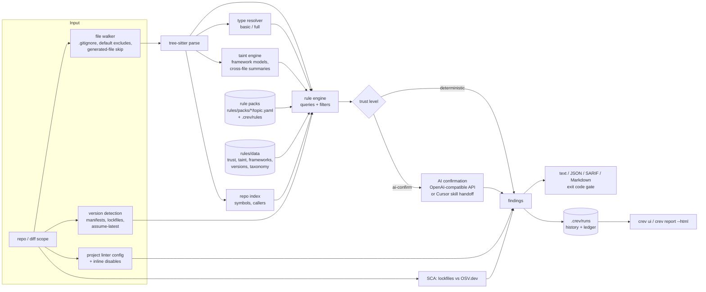

# crev: version-aware code review

crev is a command-line code reviewer for pull requests and whole repositories. It reports code quality,
security, accessibility, deprecation and migration findings. Every rule cites the official documentation
it is based on and declares the language, framework or tool versions it applies to. crev aims for few
false positives: a rule without external evidence of precision does not report directly. Its hits are
first checked by an AI confirmer.

Status: v0.1.0, local and CI use. Not yet released as binaries.

## Why

- **Version-aware.** crev detects versions from manifests and lockfiles (`go.mod`, `package.json`, `pom.xml`,
  Gradle, `composer.json`, `pyproject.toml`, ...). Rules carry `applies_to` ranges, so a Spring Boot 2
  project does not get Spring Boot 3 advice, and the reverse. When a framework is present but its version
  cannot be detected, crev assumes the latest known release (`rules/data/latest-versions.yaml`) and marks
  the finding with `assumed_versions`.
- **Doc-cited.** Each rule has a `source` with the URL and a quote from the official page. `tools/ruleupdate`
  checks that the quotes are still on those pages.
- **Low false positives.** Every rule needs bad, good and regression examples, and all of them are executed.
  Rules are measured against linter test suites, OWASP benchmark apps and pinned OSS repositories before
  they report directly (see [Trust levels](#trust-levels-and-ai-confirmation)).
- **Respects the project.** If a rule is switched off in the project's linter config (eslint,
  typescript-eslint, golangci-lint, ruff/flake8/pylint/mypy, detekt/ktlint, Checkstyle/PMD/SpotBugs/
  Error Prone, PHPStan/Psalm/PHPCS, hadolint, tflint, checkov, yamllint, buf, tsconfig, .editorconfig) or
  disabled inline (`eslint-disable`, `//nolint`, `# noqa`, `@SuppressWarnings`, ...), the equivalent crev
  rule is suppressed. Suppressed findings stay in JSON/SARIF output.

## How it works



- **Parsing:** tree-sitter through `github.com/tree-sitter/go-tree-sitter`. Most grammars come from Go
  modules. The Dockerfile, GraphQL, Protobuf and Vue grammars are vendored under `internal/grammars/`.
- **Rule packs:** one directory per pack with small topic files under `rules/packs/<pack>/`, for example
  `quality`, `security`, `migration`, `modernization`, `maintainability`, `accessibility` and `taint`.
  `*.gen.yaml` files are generated from `tools/rulegen/specs/*.py`. The other YAML files are hand-written.
  The packs are embedded in the binary (`rules/embed.go`). Schema: `schemas/rule-pack.schema.json`.
- **Filters:** a tree-sitter query can be narrowed with filters on captures, parent, ancestors, function
  and file text, resolved types, parameters and duplicated branches. The full list is in `rules/README.md`.
- **Type resolver** (`internal/types`): syntax-only and conservative. When nothing is declared, the type
  is unknown, and rules treat unknown as unknown, never as "not X". `--types basic` works per file and is
  the default. `--types full` adds a cross-file index prepass.
- **Taint** (`internal/taint`, `rules/data/taint.yaml`, `rules/data/frameworks.yaml`): source-to-sink
  rules for Java, Kotlin, Python, JavaScript/TypeScript, PHP and Go. Framework models only apply in files
  that import the framework. `frameworks.yaml` currently models javalin, quarkus-rest, spring-webflux
  (functional), nestjs, hapi, fiber, chi, falcon, aiohttp, symfony-http-foundation, psr-7 and
  codeigniter4. Built-in language blocks cover common frameworks such as Spring, Flask, Django and
  Express. Cross-file function summaries are on by default (`cross_file_taint: false` disables them).
- **Simplification rules** (`engine: index`) use a repo-wide symbol and caller index (`crev index`).
- **SCA:** lockfiles (npm, yarn, pnpm, composer, Go, Poetry, Pipfile, pinned requirements, Gradle
  lockfiles, pom.xml) are matched against OSV.dev, either online or with offline databases from
  `crev vulndb update`.
- **Run history:** each scan is stored under `.crev/runs`, with a per-branch ledger of new, fixed and
  persisting findings (`.crev/runs/<branch>/history.json`). `crev runs list|show|prune`, `crev ui` (a local, read-only web UI on 127.0.0.1:7317)
  and `crev report --html` read it. `--no-run` skips recording.
- **Diff scopes:** `--base REF [--head REF]`, `--staged`, `--working-tree`, `--commits A..B|A...B`, with
  `--diff-context hunk|file`. With a diff scope, findings are reported only on changed lines (`hunk`) or
  in changed files (`file`).
- **Progress:** shown on stderr. `--progress auto|bar|plain|off`: auto shows a bar on a TTY and nothing in
  CI. `--quiet` silences progress and informational lines.

### Trust levels and AI confirmation

Each rule declares `detection.mode: deterministic` or `ai-confirm`. `tools/trust` computes a trust level
per rule (`rules/data/trust.yaml`) from external evidence:

- linter test suites imported as must-match / must-not-match cases;
- OWASP Benchmark results;
- pinned OSS corpus runs, with volume and concentration anomaly checks;
- sampled human labels;
- metamorphic stability of each rule's examples.

The levels are `proven`, `measured`, `unproven` and `quarantined`. With the default
`trust.deterministic_min: measured`, unproven deterministic rules run as ai-confirm. The exception is
`match_kind: exact-api` rules: version-gated deprecation and removal rules that match an exact
identifier, import, config key or dependency. Quarantined rules run in shadow mode: they are recorded
but never listed and never gate.

An ai-confirm hit becomes `pending_ai` until a confirmer answers. Only `ai_confirmed` findings at or
above `review_confidence` (default `high`) enter the review list. The confirmer is either:

- **an OpenAI-compatible chat-completions endpoint** (`ai.base_url`, `ai.model`, and the key in the env
  var named by `ai.api_key_env`, default `CREV_AI_API_KEY`; `CREV_AI_BASE_URL` and `CREV_AI_MODEL`
  override the config). Requests are batched and compressed, and verdicts are cached by content;
- **the Cursor skill** (`skills/crev-review`): `crev ai export` writes `.crev/ai-handoff/batches.jsonl`,
  an agent writes verdicts, and `crev ingest FILE` applies them to the run and re-gates.

## Supported languages and frameworks

32 packs, 3325 rules. Run `crev rules list` for the full catalog.

| area | packs |
|---|---|
| Languages | go, java, kotlin, javascript (incl. JSX), typescript (incl. TSX), python, php |
| Web / a11y | html (incl. accessibility), css (incl. accessibility), vue, react, angular, nuxt, nuxt-ui, vueuse, payload, graphql |
| JVM / build | spring-boot, gradle, maven, android, composer, package-json |
| Infra / config | docker, kubernetes, terraform, github-actions, gitlab-ci, yaml, json, protobuf, ytt |

Rule counts per pack, deterministic vs ai-confirm after trust, are printed by
`go run ./tools/rulecheck $(find rules/packs -name '*.yaml')`.

## Install / build

You need Go (`go.mod` declares `go 1.23` with `toolchain go1.27.2`; the go command fetches the
toolchain automatically) and a C compiler. **cgo is required** because the tree-sitter grammars are C.
Cross-compiling needs a C toolchain for each target, for example zig as `CC`.

```bash
git clone <this repo> && cd code-review-engine
CGO_ENABLED=1 go build -o crev ./cmd/crev
./crev version
```

## Quickstart

```bash
crev init                                  # writes .crev.yaml and an empty .crev/rules/
crev scan .                                # whole repo, text report
crev scan . --base origin/main             # only lines changed since the merge-base
crev scan . --staged                       # pre-commit
crev scan . --format json --output sarif=crev.sarif --output md=crev.md
crev scan . --show-hidden=pending,suppressed   # also list hidden findings
crev versions .                            # detected version facts (assumed-latest marked)
crev rules show <RULE-ID>                  # rule text, source, examples, trust level
crev ui                                    # browse runs at http://127.0.0.1:7317
crev feedback fp <FINGERPRINT> --reason "..."   # record a false positive (fp | undo | list)
```

Suppress a single finding inline with `crev-ignore RULE-ID`, `crev-ignore-next-line RULE-ID` or
`crev-ignore-file RULE-ID` (or `all`) in a comment.

## CI usage

Exit codes: `0` no gating findings · `1` gating findings at or above `fail_on` (default `critical`) ·
`2` usage or config error · `3` engine error · `4` `--ai required` and findings left without a verdict.

Every finding is still reported (text, JSON, SARIF, Markdown). Only the exit code depends on `fail_on`.
Pending AI findings do not gate unless you pass `--strict-pending`.

```yaml
# GitHub Actions (sketch)
- run: CGO_ENABLED=1 go build -o crev ./cmd/crev
- run: ./crev scan . --base origin/${{ github.base_ref }} --output sarif=crev.sarif --fail-on critical
- uses: github/codeql-action/upload-sarif@v3
  if: always()
  with: { sarif_file: crev.sarif }
```

Persist `.crev/cache/ai` between CI runs to reuse AI verdicts. To use the API confirmer in CI, set
`CREV_AI_BASE_URL`, `CREV_AI_MODEL` and `CREV_AI_API_KEY`.

## Configuration (`.crev.yaml`)

`crev init` writes the commented template (`internal/config/template.crev.yaml`). Key options:

| key | default | meaning |
|---|---|---|
| `fail_on` | `critical` | gate threshold: info, minor, major, critical or none |
| `packs` | all | packs or theme tags to run |
| `custom_rules` | `[.crev/rules]` | user rule dirs, files or globs |
| `unknown_version_policy` | `assume-latest` | behaviour when a dimension is present but has no version |
| `ai.mode` / `ai.provider` | `auto` / `auto` | `off`/`auto`/`required`; `api`/`cursor-skill`/`auto` |
| `ai.base_url`, `ai.model`, `ai.api_key_env` | | OpenAI-compatible endpoint; never put the key in the file |
| `ai.min_confidence`, `review_confidence` | `medium`, `high` | AI confidence thresholds |
| `trust.deterministic_min` | `measured` | `unproven` keeps every rule's declared mode (more findings, more FPs) |
| `respect_project_config` | `true` | honour linter configs and inline disables |
| `default_excludes`, `gitignore`, `skip_generated` | `true` | file selection |
| `ignore` | `[]` | extra globs |
| `rules` | `{}` | per-rule `enabled` / `severity` |
| `types` | basic | `basic`, `full` or `off` |
| `cross_file_taint` | `true` | cross-file taint prepass |
| `vulndb.mode` | `online` | `online` sends package names and versions to api.osv.dev; `offline`; `off` |
| `runs.keep`, `runs.max_age_days` | 50, 90 | run-history pruning |
| `baseline`, `state_dir` | `.crev-baseline.json`, `.crev` | |

CLI flags override the config: `--fail-on`, `--ai`, `--provider`, `--packs`, `--types`, `--vulndb`,
`--no-project-config`, `--no-gitignore`, `--no-default-excludes`, `--include-generated` and others.
Run `crev help` for the full list.

## Custom rules

Put YAML files under `.crev/rules/`. They are layered over the built-in catalog by rule id. A new id
adds a rule. A built-in id with some fields patches it (deep merge). `override: replace` replaces the
built-in, and `disabled: true` removes it. Validate them with `crev rules validate [--strict]`. The
format, filters and examples are described in `rules/README.md`. Schema:
`schemas/custom-rules.schema.json`.

## Developer tools

None of these ship in the binary.

| tool | purpose |
|---|---|
| `go run ./tools/rulecheck $(find rules/packs -name '*.yaml')` | validate every rule: schema, source, examples executed, trust and governance |
| `python tools/rulegen/rulegen.py` | regenerate `*.gen.yaml` from `tools/rulegen/specs/*.py` (also `sources.py`, `taxonomy.py`, `xref.py`, `optin.py`) |
| `go run ./tools/ruleupdate [-latest] [-fail-on-review]` | doc drift: re-fetch cited pages, verify quotes, flag new deprecations and new latest versions; writes `.ruleupdate/report.md` and never edits rules |
| `go run ./tools/corpus fetch\|run\|summarize\|diff\|sample\|fixtures\|govern\|bench\|fixdiff\|slow` | false-positive harness: pinned OSS repos, benchmark apps and linter test suites (`tools/corpus/README.md`) |
| `go run ./tools/trust compute -label <run>` / `metamorphic` | compute `rules/data/trust.yaml` and `tools/trust/report.md` |
| `python tools/gap/{sonar,semgrep,snyk,owasp,cwe}.py` | coverage checklists against external rule catalogs, by key/CWE only |
| `tools/bench/*.py` | crev vs AI-review benchmark (`tools/bench/README.md`) |
| `go run ./tools/astdump`, `./tools/sexp`, `./tools/tsq` | print tree-sitter trees and query captures while writing rules |

**Updating rules:** edit a spec (or a hand-written YAML), add a regression example for every false
positive you fix, then run `rulegen.py` and `rulecheck` (it must report 0 failures) and `go test ./...`.
Run `ruleupdate` on a schedule to catch doc changes. After a corpus rescan, run `trust compute` to
refresh trust levels.

## Licensing notes

- Vendored grammars (`internal/grammars/{dockerfile,graphql,proto,vue}`) are MIT-licensed; each directory
  has its LICENSE. The other grammars are Go module dependencies.
- Rules are crev's own text with citations to official documentation. No rule text, descriptions or
  examples are copied from Sonar, Semgrep or Snyk. `tools/gap` stores only rule keys, counts and CWE ids
  from those catalogs. Their titles stay in a local, gitignored cache.
- Corpus clones, linter fixtures, benchmark apps and raw results (`tools/corpus/cache`,
  `tools/corpus/results/*/raw`, `tools/bench/cache`, `tools/gap/cache`) are local only. They are never
  committed or embedded.
- No LICENSE file for crev itself has been added yet.

## Current metrics (honest, with caveats)

All numbers come from committed reports dated 2026-10-10/11. They measure crev against its own harnesses
and are not independent evaluations.

- **Catalog:** 3325 rules, 0 rulecheck failures. Trust: 184 proven, 561 measured, 2564 unproven,
  16 quarantined. 1324 rules run deterministically and 2001 need AI confirmation
  (`tools/trust/report.md`, corpus run `m7`, 90 pinned repos).
- **Linter test suites** (`tools/corpus/results/fixtures-m7fx/report.md`): 485 rules with an equivalent
  suite; overall precision 0.879 and recall 0.425. Rules that report without AI: TP 1802, FP 0. Recall is
  low by design: many rules implement only the safest subset of the linter rule.
- **OWASP Benchmark** (`tools/corpus/results/m4/bench.md`): Java review list TPR 0.59 at FPR 0.00
  (candidates before AI confirmation: TPR 0.87, FPR 0.01). Python review list TPR 0.00 (candidates: TPR
  0.92, FPR 0.05). The Python rules still need AI confirmation, and that path was not run with a real
  endpoint.
- **Coverage checklists** (`tools/gap/`): Sonar way core profile mapped by xref or CWE family: Go 69%,
  Kotlin 61%, PHP 61%, JS 57%, Java 55%, TS 53%, Python 47%. A mapped rule does not mean the same
  detection depth. ASVS 5.0: 121/121 requirements that crev judged code-verifiable have a rule (the
  judgement is crev's own). CWE Top 25 (2024): 18/19 applicable entries.
- **PR benchmark** (`tools/bench/report.md`, 91 PRs): crev alone found 17 of 65 labelled issues (recall
  0.26) with precision 1.00 [0.89-1.00] and no findings on clean PRs. Plain AI review found more (recall
  0.80) but raised invalid findings on 21% of clean PRs. **Caveat:** no independent AI endpoint was
  available. The AI reviewer, the AI confirmer and the judge were the same agent that built the
  benchmark, so the AI numbers are upper bounds.

## Repository layout

```
cmd/crev/          CLI
internal/          engine, rules loader, types, taint, index, versions, projcfg, sca, ai, runs, ui, report
rules/packs/       rule packs (embedded);  rules/data/  trust, taint, frameworks, versions, taxonomy
schemas/           JSON schemas (rule pack, custom rules, finding, AI handoff)
skills/crev-review Cursor skill for AI confirmation
tools/             dev tools (see above);  sources.yaml / sources.md  cited documentation
PLAN.md            design notes and decisions
```
